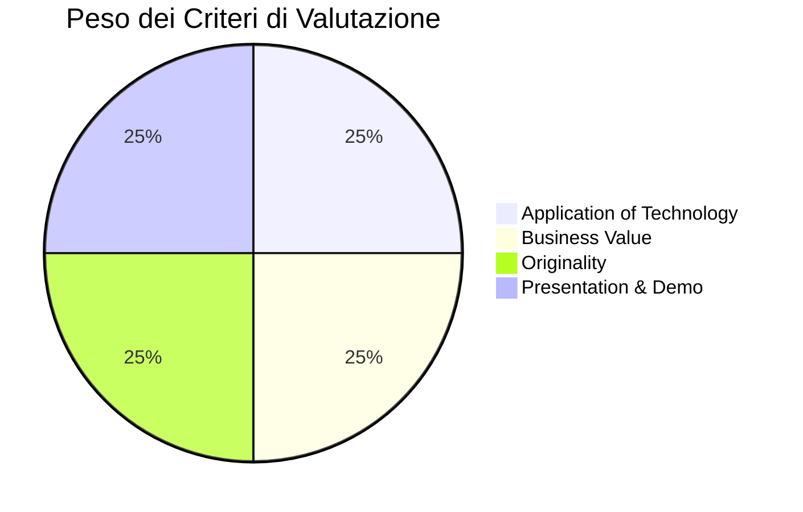

# Premi e Criteri di Valutazione: AMD ACT III 🏆

In questo documento sono analizzati nel dettaglio il montepremi complessivo (**$12,000+**), i premi partner speciali e le griglie di valutazione adottate dai giudici.

---

## 1. Dettaglio del Montepremi 💰

Il montepremi supera i **$12,000 complessivi** ed è composto da premi in denaro, crediti cloud/piattaforma e premi hardware esclusivi:

| Categoria Premio | Valore | Erogatore | Dettagli |
| :--- | :--- | :--- | :--- |
| **AMD Main Prizes** | **$5,000** | AMD | Assegnati ai migliori progetti complessivi che sfruttano la tecnologia e l'infrastruttura AMD. |
| **Google Prizes** | **$5,000** | Google | Assegnati ai progetti eccellenti che integrano tecnologie/modelli partner (es. open models, Google Cloud, Gemma, ecc.). |
| **Vibe Generation Special Prize** | **AirPods 5 per tutto il team** | Vibe Generation | Cuffie Apple AirPods 5 per ciascun componente del team vincitore. |
| **Evolus Track Prizes** | **€1,011.50** | Evolus AI | Piani Developer e crediti per il podio della track Evolus Business Agents. |

> [!TIP]
> **I premi sono cumulabili!**
> Un singolo progetto può concorrere e vincere contemporaneamente:
> 1. Il premio principale AMD
> 2. Uno o entrambi i premi partner (Google / Evolus)
> 3. Il premio speciale hardware Vibe Generation (AirPods 5)

---

### Dettaglio Premi Track Evolus AI (€1,011.50 tot.)

- 🥇 **1° Classificato**: **€578** (12 mesi di piano Evolus Developer per il team + 1.000.000 crediti bonus + vetrina showcase dedicata su evolus.ai).
- 🥈 **2° Classificato**: **€289** (6 mesi di piano Evolus Developer per il team + 500.000 crediti bonus).
- 🥉 **3° Classificato**: **€144.50** (3 mesi di piano Evolus Developer per il team + 250.000 crediti bonus).

---

## 2. Criteri di Valutazione Generali (Standard LabLab / AMD) ⚖️

Tutte le sottomissioni per le 4 tracce principali vengono valutate su 4 pilastri fondamentali:

### 1. ⚙️ Application of Technology (Applicazione Tecnologica)
- Quanto profondamente ed efficacemente sono integrati i modelli AI e le tecnologie scelte.
- **Evidenza AMD**: Utilizzo reale e significativo di acceleratori AMD, ROCm, AMD Developer Cloud o vLLM.
- Solidità architetturale, stabilità del software e qualità del codice (modularità, containerizzazione, sicurezza).

### 2. 💼 Business Value (Valore di Business)
- Il progetto risolve un problema concreto per un utente reale identificabile?
- Ritorno sull'investimento (ROI) o guadagno tangibile: risparmio di tempo, riduzione costi operativi, aumento conversioni o miglioramento della sicurezza.
- Fattibilità economica e scalabilità nel mondo reale.

### 3. 💡 Originality (Originalità & Innovazione)
- Il concept introduce una prospettiva nuova o automatizza un processo in modo inedito?
- Capacità di superare le solite "demo banali" (es. non un semplice wrapper di una chat con prompt statico).
- Capacità di far emergere comportamenti intelligenti e interazioni avanzate.

### 4. 🎬 Presentation (Presentazione & Demo)
- Chiarezza, ritmo e incisività del video demo (2-3 minuti).
- Qualità del Pitch Deck: il problema, il mercato, la soluzione e la validazione tecnica sono esposti senza tecnicismi oscuri.
- Completezza della documentazione nella repository GitHub (README pulito, architettura, facilità di replica).

---

## 3. Criteri Specifici: Premio Speciale Vibe Generation 🎧

Il partner **Vibe Generation** (fondato da Paolo Bonetti) assegna le cuffie **AirPods 5** a tutti i membri del team vincitore valutando il progetto su 3 dimensioni qualitative:

| Dimensione | Descrizione | Cosa cercano i valutatori |
| :--- | :--- | :--- |
| **1. Hybrid** | Pensiero strategico, quantificazione del valore e attitudine commerciale. | La capacità di concepire una soluzione in cui l'AI potenzia il talento umano senza pretendere di sostituirlo a casaccio, con chiara comprensione del modello di business. |
| **2. Becreatives** | Qualità dell'esecuzione tecnica, orchestrazione degli strumenti AI, capacità di spedire (ship). | Un software funzionante e curato, capace di orchestrare modelli, agenti, database e UI in modo fluido. |
| **3. Vibe Generation** | Gusto estetico, originalità del concept, design del workflow collaborativo Uomo + AI. | Attenzione al design, eleganza dell'interfaccia utente, UX piacevole e un'interazione naturale e accattivante tra operatore umano e intelligenza artificiale. |

---

## 4. Come Massimizzare il Punteggio: Strategia Vincente 🚀

1. **Non fare un "Mockup", fai un "Working Product"**: I giudici penalizzano i progetti che sono solo presentazioni o prototipi finti (Figma). La soluzione deve elaborare dati veri e produrre output veri.
2. **Documenta AMD con Metriche (Benchmark)**: Includi nel README un paragrafo con i test di latenza o throughput ottenuti su AMD Developer Cloud / ROCm (es. `"Inferenza eseguita su AMD Instinct con vLLM: 45 tok/s con FP16"`).
3. **Includi i "Guardrails" e la "Safety"**: Mostrare dove il modello potrebbe sbagliare e come l'utente umano viene avvisato o interviene aumenta notevolmente il punteggio di affidabilità e maturità di business.
4. **Cura la UI/UX**: L'aspetto visivo e la fluidità d'uso sono determinanti per il premio Vibe Generation e per il criterio *Presentation*.
