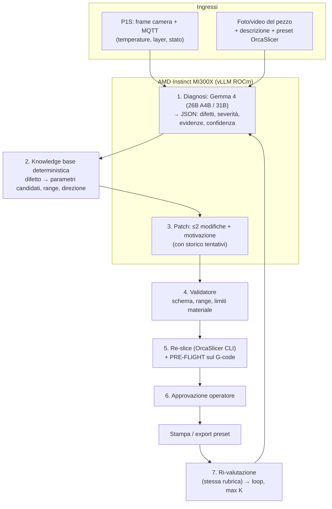

# 01. PrintLoop — Diagnosi visiva e correzione dei preset in closed loop 🖨️🔁

> **Nome provvisorio.**
> **Track di riferimento:** Track 1: Intelligent Industry
> **Target premi:** AMD Main Prize + Google Prize (Gemma 4) + Vibe Generation (workflow ibrido Uomo+AI)
> **Stato:** concept validato a tavolino, in attesa degli spike tecnici (sezione 9)

---

## 1. Pitch

Quando una stampa 3D esce male, oggi il processo è manuale: l'operatore guarda il pezzo, intuisce la causa, cambia qualche parametro nello slicer e riprova. Funziona solo se ha esperienza.

**PrintLoop automatizza questo ciclo, mantenendo l'umano nel loop.** Guarda la stampa (live o a posteriori), identifica il difetto, propone una **modifica minima e verificabile** al preset di OrcaSlicer, controlla che la modifica produca davvero l'effetto atteso nel G-code, e chiude il ciclo dopo la ristampa.

### Perché non è "foto → alert → ticket"

I progetti concorrenti già visti su lablab.ai si fermano alla notifica. PrintLoop:

- ricava la **causa**, non solo il sintomo;
- produce una **patch** del preset, non un suggerimento generico;
- **verifica** la patch sul G-code prima di stampare (pre-flight);
- **misura** il miglioramento dopo la ristampa con la stessa rubrica.

> **Origine dell'idea:** il team ha già fatto correggere a un agent (Antigravity) i preset OrcaSlicer descrivendo a mano il problema (bridge che cedono, sovra-estrusione), con successo. PrintLoop sostituisce la descrizione manuale con vision + telemetria e rende la correzione verificabile.

### Utente e KPI

- **Utente:** operatore/tecnico di un reparto di stampa 3D o piccola officina additiva (e per estensione chi qualifica processi su macchine simili).
- **KPI:** iterazioni necessarie per arrivare a un pezzo accettabile, materiale e tempo sprecati (g, min), difetto prima/dopo con rubrica fissa.

---

## 2. Due modalità, una pipeline

Le modalità funzionano **stand-alone o in cascata**. Il Modo 1 è il *trigger*, il Modo 2 è il *motore di correzione*.

| | Modo 1: live | Modo 2: post-stampa |
|---|---|---|
| **Input** | Frame dalla camera della P1S + telemetria MQTT | Foto/video del pezzo + descrizione opzionale + preset |
| **Azione** | Rileva, mette in pausa/ferma, passa le prove al Modo 2 | Diagnosi → patch → verifica → approvazione → ristampa |
| **Valore** | Risparmio di materiale e tempo | Correzione completa |
| **Qualità input** | Bassa (camera di bordo, pochi fps) | Alta (telefono, più angoli) |
| **Rischio** | Alto | Medio |

Nel Modo 1 **non si cambiano preset a stampa in corso**: i parametri sono incorporati nel G-code. Al massimo si usano override semplici (velocità) se il firmware li accetta. La correzione vera avviene alla ristampa.

---

## 3. Architettura

### Scelte di progetto

1. **Tassonomia chiusa di difetti** (~8-10 classi, es. sotto-estrusione, sovra-estrusione, stringing, bridge che cedono, warping/distacco, layer shift, spaghetti, primo layer, ringing). Output strutturato, con confidenza e frame di evidenza.
2. **Knowledge base deterministica** difetto → parametri candidati con direzione e range ammessi. Il modello **sceglie** tra opzioni vincolate, non inventa parametri.
3. **Un fix alla volta**: massimo 2 parametri per iterazione, con memoria dei tentativi per non oscillare.
4. **Pre-flight sul G-code**: dopo il re-slice si confrontano metriche (es. velocità dei bridge, flusso volumetrico vs limite del materiale, raffreddamento per layer) per verificare che la patch si sia propagata e non introduca nuovi rischi. È il nucleo verificabile del progetto.
5. **Metrica oggettiva**: stessa rubrica di severità prima e dopo, non solo "l'utente accetta".

---

## 4. Flusso operativo (esempio)

1. L'operatore stampa un pezzo con bridge. Il Modo 1 vede il materiale cedere e mette in pausa, oppure l'operatore carica foto del pezzo finito nel Modo 2.
2. **Diagnosi:** "bridge che cedono, severità alta, confidenza 0,8, evidenza: frame 12-15".
3. **KB:** parametri candidati = velocità bridge, flusso bridge, ventola sui bridge.
4. **Patch:** velocità bridge 50 → 30 mm/s, ventola bridge 100%.
5. **Pre-flight:** conferma nel G-code che le sezioni bridge ora sono a 30 mm/s e con ventola piena; nessun superamento del flusso massimo.
6. **Approvazione** e ristampa. **Ri-valutazione:** severità da alta a bassa, oppure nuova iterazione.

---

## 5. Dati e valutazione

**Il dataset lo produciamo noi**, ed è il punto di forza: pezzi di test (10-20 min ciascuno) con difetti **indotti e noti** (flow troppo alto, raffreddamento off, bridge veloci, temperatura bassa), con foto, preset e G-code etichettati.

| Metrica | Come si misura |
|---|---|
| Accuratezza di diagnosi | Difetto previsto vs difetto indotto |
| Correttezza della patch | La modifica corregge il parametro causa e il pre-flight la conferma |
| Iterazioni al successo | Numero di cicli fino alla rubrica sotto soglia |
| Spreco evitato (Modo 1) | Grammi e minuti risparmiati vs stampa fino in fondo |
| Modello | Gemma 26B A4B vs 31B: accuratezza e latenza |

I casi già risolti a mano in passato (preset prima/dopo) sono il **primo test set** e il banco di prova per capire se un modello open eguaglia l'agent usato finora.

**Dataset pubblici di supporto** (opzionali): [Roboflow 3D_FDM_faults_detection](https://universe.roboflow.com/wangdada/3d_fdm_faults_detection-krkkr) (CC BY 4.0, classi da verificare) e [AGH 3D printer anomalies](https://arxiv.org/pdf/2004.08817) (CC BY 4.0).

---

## 6. Evidenza AMD

- **Serving:** Gemma 4 26B A4B e 31B (input immagine e video, nessun audio necessario) su vLLM-ROCm, MI300X. [vLLM recipe Gemma 4](https://docs.vllm.ai/projects/recipes/en/latest/Google/Gemma4.html).
- **Benchmark reale:** confronto 26B vs 31B su accuratezza e latenza della diagnosi, throughput con più richieste concorrenti (print farm simulata riproducendo gli stessi video, dichiarato come simulato).
- **Opzionale:** fine-tuning di un detector leggero su ROCm con tempo misurato.

> Nota: il video non è uno stream per il modello. vLLM lo scompone in frame con timestamp (fino a 32 frame per richiesta). L'analisi è a campionamento, non a 30 fps.

---

## 7. Guardrails e Human-in-the-loop

- **Nessuna modifica automatica senza approvazione** dell'operatore.
- **Range e limiti hard** per ogni parametro e per le temperature del materiale (validatore deterministico).
- **Pausa/stop sempre consentiti**, mai azioni che aumentano il rischio (es. alzare temperature oltre il limite).
- **Dichiarazione di incertezza:** sotto una soglia di confidenza il sistema non propone patch ma chiede un'ulteriore foto o un controllo manuale.
- **Limite di iterazioni K:** oltre, escalation all'umano con lo storico.
- **Failure cases dichiarati** nella consegna (difetti fuori tassonomia, causa meccanica non risolvibile dal preset, es. cinghia lenta o ugello danneggiato).

---

## 8. Rischi

| Rischio | Mitigazione |
|---|---|
| Comandi in Developer Mode più limitati del previsto | Spike iniziale su pausa/stop/velocità/`gcode_line`. In caso, il Modo 1 si limita ad allerta e stop |
| Camera P1S di bassa qualità | Modo 1 solo per difetti grossolani, difetti fini nel Modo 2 con foto del telefono |
| Prior art (rilevamento spaghetti, Obico) | Non competere sull'allarme: differenziatore = causa → patch → verifica → loop |
| Gemma 4 più debole dell'agent frontier | Test sui casi passati nelle prime ore, prima di costruire |
| Re-slice via CLI fragile (preset con `inherits`, possibile `xvfb`) | Fallback: esporta il preset patchato per import manuale |
| Autorizzazione firmware Bambu | Usare **solo** Developer Mode (percorso ufficiale). Nessun bypass dei certificati |

---

## 9. Spike tecnici da fare per primi

Ogni spike è breve e decide un ramo del progetto.

- [ ] **P1S Developer Mode:** connessione MQTT, lettura telemetria, frame dalla camera (porta 6000), prova di pausa/stop/velocità/`gcode_line`.
- [ ] **OrcaSlicer CLI:** appiattire un preset con `inherits`, slicing headless di un 3mf, parsing del G-code risultante.
- [ ] **Gemma su AMD:** avvio del modello su vLLM-ROCm, verifica input immagine e video, prova sui casi passati.
- [ ] **Casi storici:** recuperare preset prima/dopo e foto dei difetti già corretti.

---

## 10. Piano (restano pochi giorni)

| Fase | Obiettivo |
|---|---|
| Spike (subito) | I 4 controlli sopra |
| Giorno 2 | Pipeline Modo 2 end-to-end + serie di stampe con difetti indotti |
| Giorno 3 | Modo 1 come trigger, UI di approvazione, valutazione e benchmark AMD |
| Giorno 4 | Video demo, README, diagramma, pitch |

---

## 11. Fonti

- [Bambu Lab limits third-party printer control (All3DP)](https://all3dp.com/4/bambu-lab-limits-third-party-printer-control-with-new-security-update/)
- [SimplyPrint: Bambu webcam guide](https://simplyprint.featurebase.app/help/articles/u8nmfm-bambu-lab-integration-webcam-setup-and-usage-guide)
- [OrcaSlicer CLI mode (wiki)](https://www.orcaslicer.com/wiki/cli/cli_mode)
- [Google AI: Gemma core docs](https://ai.google.dev/gemma/docs/core)
- [vLLM recipes: Gemma 4](https://docs.vllm.ai/projects/recipes/en/latest/Google/Gemma4.html)
