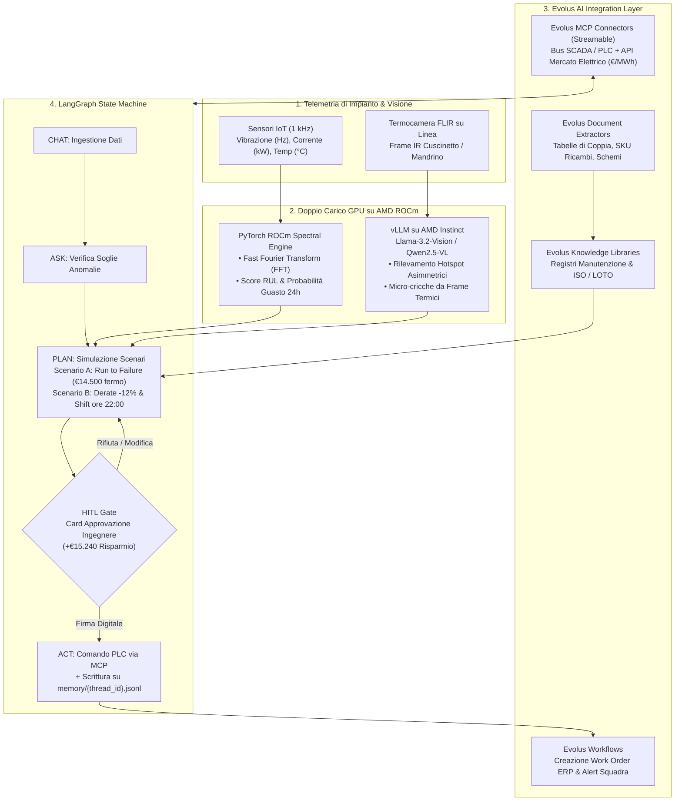
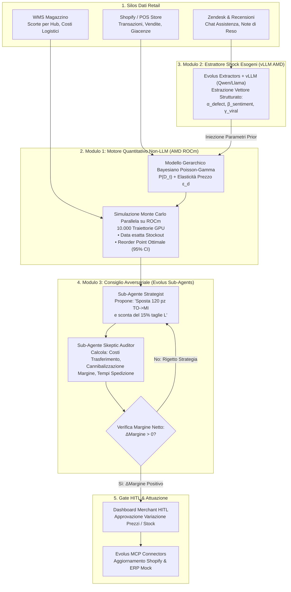
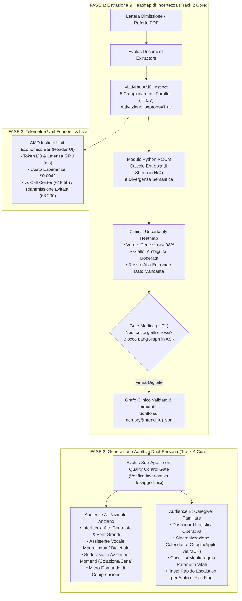

# Nuove Idee di Progetto: AMD ACT III & Evolus Business Agents 🚀

> **Documento di Specifica e Architettura Tecnica**  
> **Contesto:** AMD Developer Hackathon: ACT III (12–18 Ottobre 2026)  
> **Target Principali:** Track 1, Track 2, Track 3, Track 4 & Partner Track *Evolus Business Agents on AMD*

---

## 🧭 Matrice Comparativa delle Nuove Idee

| Progetto | Track Principale | Track Secondaria / Partner | Stack Computazionale AMD | Meccanismo Human-in-the-Loop (HITL) | Differenziatore Chiave |
| :--- | :--- | :--- | :--- | :--- | :--- |
| **ChronosGrid-MCP** | **Track 1** (Intelligent Industry) | **Evolus Partner Track** | ROCm PyTorch (FFT Spettrale) + vLLM Vision (Termocamere) | Blocco comandi PLC/SCADA con approvazione scenario di mitigazione | Oltre il semplice RAG: unisce predizione del guasto meccanico e riprogrammazione oraria per arbitraggio tariffe energetiche (€/MWh). |
| **MarginSwarm** | **Track 3** (Reinvent Commerce) | **Evolus Partner Track** | ROCm PyTorch (Bayesiano Poisson-Gamma 10k MCMC) + vLLM (NLP Shock) | Approvazione spostamenti stock e variazione prezzi dopo audit avversariale | Pieno rispetto del vincolo Track 3 (*no forecasting solo-LLM*): motore quantitativo matematico su ROCm arricchito da shock esogeni qualitativi. |
| **ClaritasCare-HITL** | **Track 2** (Health & Wellbeing) | **Track 4** (New Experience) + **Evolus Partner Track** | vLLM (`logprobs=True`, $N=5$) + Entropia di Shannon su ROCm | Heatmap di incertezza clinica: blocco finché il medico non valida nodi gialli/rossi | Tripla conformità: zero diagnosi autonoma (Track 2), generazione Dual-Persona adattiva (Track 4) e Unit-Economics Bar live con ROI certificato. |

---

## 🏭 IDEA 1: ChronosGrid-MCP

### Scheda Sintetica

```
Track Principale: Track 1 (Intelligent Industry)
Partner Track:    Evolus Business Agents on AMD
Target Premi:     AMD Main Prize, Vibe Generation (Track 1), Evolus Business Agents
Posizionamento:   Orchestratore Autonomo di Manutenzione Predittiva Multi-Modale e 
                  Arbitraggio Energetico Industriale su AMD ROCm
```

---

### 1. Il Problema Reale e Perché Batte gli Altri Progetti della Track 1

Nelle fabbriche europee e italiane, i responsabili di impianto (Plant Manager, Maintenance Lead) affrontano quotidianamente due crisi simultanee:
1. **I fermi macchina imprevisti** (un cuscinetto grippato su un mandrino CNC o un compressore d'aria industriale genera costi medi di oltre **€14.500 all'ora** tra blocchi linea, operai inattivi e scarti);
2. **La volatilità estrema del prezzo orario dell'energia elettrica industriale** (PUN e mercato spot intra-day con oscillazioni tra €80/MWh nelle ore notturne fino a picchi superiori a €200/MWh durante le ore di punta).

> [!WARNING]
> **La trappola dei progetti concorrenti nell'hackathon:**  
> La quasi totalità dei progetti della Track 1 si riduce a un banale chatbot RAG su manuali tecnici in PDF: l'operatore scrive *"il compressore fa uno strano fischio"* e l'assistente cita la pagina 45 del manuale. Questo approccio è passivo, tardivo e non crea reale valore economico.

**ChronosGrid-MCP agisce a monte e chiude l'intero ciclo operativo:**
- **Rileva il degrado meccanico prima della rottura** combinando sensori ad alta frequenza (FFT su vibrazioni e assorbimento) e visione artificiale (termografia all'infrarosso).
- **Estrae la procedura e i pezzi esatti dal manuale OEM** tramite gli estrattori strutturati di Evolus.
- **Riprogramma automaticamente i lotti produttivi ad alto assorbimento energetico**, spostandoli nelle fasce orarie a tariffa elettrica ridotta per non sovraccaricare il componente usurato prima dell'intervento di manutenzione programmata.

---

### 2. Architettura Tecnica Profonda



#### A. Layer Computazionale AMD (Doppio Carico GPU)
1. **Motore Spettrale PyTorch su ROCm**:
   - Modello compatto in PyTorch accelerato nativamente su GPU AMD Instinct via ROCm.
   - Esegue una **Trasformata Rapida di Fourier (FFT)** sui flussi di telemetria ad alta frequenza (vibrazioni assiali/radiali a 1–5 kHz, temperatura in °C e assorbimento elettrico istantaneo in kW).
   - Calcola in tempo reale lo score di **Remaining Useful Life (RUL)** e la probabilità di guasto nelle successive 24 ore.
2. **Inferenza Multi-Modale e Reasoning su vLLM**:
   - Modello open-weight multimodale (es. `Llama-3.2-Vision` o `Qwen2.5-VL` abbinato a `Qwen2.5-72B-Instruct`) servito su AMD Developer Cloud tramite **vLLM**.
   - Analizza i frame termografici delle telecamere FLIR/IR di linea, identificando gradienti termici anomali, surriscaldamenti asimmetrici e micro-cricche sui cuscinetti prima della comparsa di fumo o cedimenti strutturali.

#### B. Layer di Integrazione Evolus AI (4 Building Blocks)
- **Evolus Document Extractors**: Ingerisce i manuali OEM complessi in formato PDF ed estrae tabelle con coppie di serraggio (Nm), codici componente (SKU) e schemi elettrici di collegamento.
- **Evolus Knowledge Libraries**: Indicizza lo storico delle manutenzioni passate, gli ordini di lavoro archiviati e le normative di sicurezza sul lavoro (**ISO 13849**, procedure **LOTO - Lockout/Tagout**).
- **Evolus MCP Connectors**: Utilizza l'architettura *Streamable MCP* (DevGiov stack) per interfacciare l'agente al bus SCADA/PLC (protocollo Modbus/OPC-UA simulato) e alle API del gestore energetico nazionale (prezzi orari €/MWh).
- **Evolus Workflows**: Al trigger dell'approvazione, genera automaticamente il Work Order dettagliato sull'ERP aziendale e invia la notifica operativa con checklist di intervento su Slack/Teams/WhatsApp per la squadra di reperibilità.

#### C. Macchina a Stati LangGraph: `CHAT → ASK → PLAN → HITL → ACT`
1. **CHAT / ASK**: Ricezione continua delle metriche spettrali e termiche. Se la probabilità di cedimento supera il valore soglia ($p_{\text{fault}} > 0.65$), la macchina passa allo stato **PLAN**.
2. **PLAN (Generazione Scenari)**: L'agente valuta e quantifica due alternative:
   - **Scenario A (Continuazione Invariata)**: Rischio rottura stimato al 78% entro 6 ore; costo stimato del fermo impianto: **€14.500**; assorbimento energetico in fascia di picco orario a **€185/MWh**.
   - **Scenario B (Mitigazione ChronosGrid)**: Riduzione automatica della velocità del mandrino del 12% via comando PLC; spostamento del ciclo di fresatura più energivoro alle ore 22:00 (tariffa agevolata a **€92/MWh**); azzeramento del rischio di rottura catastrofica prima del turno di manutenzione notturno.
3. **HITL (Human-in-the-Loop Gate)**: Nessun comando viene inviato direttamente al PLC. La UI presenta all'ingegnere di impianto una scheda interattiva con la stima economica certificata (**+€15.240 risparmiati**).
4. **ACT**: Solo dopo il click di approvazione dell'ingegnere, l'agente esegue i comandi via MCP sul PLC e registra l'evento crittografico su `memory/{thread_id}.jsonl`.

---

## 🛒 IDEA 2: MarginSwarm

### Scheda Sintetica

```
Track Principale: Track 3 (Reinvent Commerce)
Partner Track:    Evolus Business Agents on AMD
Target Premi:     AMD Main Prize, Vibe Generation (Track 3), Evolus Business Agents
Posizionamento:   Motore Quantitativo Bayesiano su GPU AMD ROCm accoppiato a uno Sciame 
                  Multi-Agente Avversariale per l'Arbitraggio dei Margini Retail
```

---

### 1. Il Problema Reale e il Rispetto Rigoroso della Regola sul Forecasting

I brand e-commerce e i rivenditori omnicanale perdono fino al **18% del proprio margine netto** a causa della frammentazione a silos dei dati aziendali:
- Il POS dei punti vendita fisici e la piattaforma Shopify mostrano il volume delle vendite grezze;
- I ticket di assistenza (Zendesk/Gorgias) e le recensioni dei clienti spiegano la causa reale dei resi e dell'insoddisfazione (*"la taglia M veste strettissima sulle spalle"*, *"cucitura difettosa rilevata sul lotto di Milano"*);
- Il magazzino e la logistica centrale continuano a riordinare merce difettosa o generano stockout nei negozi dove quel prodotto ha elevata richiesta locale.

> [!IMPORTANT]
> **Vincolo Tassativo della Track 3:**  
> Il regolamento ufficiale della Track 3 stabilisce:  
> *"Se il progetto prevede la previsione di vendite o domanda, **non utilizzare un LLM come unico metodo di stima!** Occorre spiegare e motivare l'algoritmo predittivo impiegato."*  
> MarginSwarm trasforma questa regola restrittiva nel proprio nucleo architetturale distintivo, separando in modo netto il calcolo probabilistico rigoroso dall'interpretazione semantica dei testi.

---

### 2. Architettura Tecnica: Separazione Matematico/Semantica



#### Modulo 1 — Il Motore Quantitativo Non-LLM (PyTorch su AMD ROCm)
- Implementa un modello predittivo puro in PyTorch eseguito direttamente su acceleratori **AMD Instinct (ROCm)**.
- Combina un modello **Gerarchico Bayesiano Poisson-Gamma** per la modellazione dei flussi di vendita con una **Simulazione Monte Carlo a 10.000 traiettorie parallele** su tensor GPU.
- Per ogni SKU calcola analiticamente:
  $$\text{Probabilità della domanda giornaliera: } P(D_t \mid \lambda, \alpha)$$
  $$\text{Elasticità della domanda al prezzo: } \epsilon_d = \frac{\% \Delta Q}{\% \Delta P}$$
  $$\text{Reorder Point (ROP): } \text{ROP} = \mu_L + Z_{\alpha} \cdot \sigma_L$$
- La dashboard espone la formulazione matematica esplicita e le bande di confidenza empiriche al **95% CI**, garantendo piena auditabilità.

#### Modulo 2 — L'Estrattore di Shock Esogeni (vLLM su AMD Developer Cloud)
- L'LLM **non produce stime di vendita**, eliminando allucinazioni numeriche.
- Il modello open-weight servito con vLLM analizza il corpus non strutturato (recensioni, trascrizioni chat di supporto, note di reso elaborate tramite *Evolus Document Extractors*) ed estrae un vettore compatto di shock qualitativi:
  $$\vec{S}_{\text{exogenous}} = \begin{bmatrix} \alpha_{\text{defect}} \\ \beta_{\text{sentiment}} \\ \gamma_{\text{viral}} \end{bmatrix}$$
- *Esempio operativo:* se l'estrattore rileva un picco anomalo del +40% nei reclami relativi alla vestibilità di un capo a Roma (*"la taglia M è troppo stretta"*), il coefficiente $\alpha_{\text{defect}}$ viene iniettato come *prior update* nel modello Bayesiano su ROCm, abbattendo la domanda attesa per la taglia M e aumentando la varianza prevista.

#### Modulo 3 — Il Consiglio Avversariale in Evolus (Strategist vs Skeptic)
Nello stato `PLAN` di LangGraph si attiva un'interazione dialettica tra due sub-agenti specializzati:
1. **Agente Strategist**: Formula un piano operativo commerciale (*"Trasferisci 120 pezzi dal magazzino di Torino a quello di Milano e imposta uno sconto del 15% sulle taglie L ferme"*).
2. **Agente Skeptic Auditor**: Critica e stressa il piano, simulando i costi vivi di trasporto corriere (€4,80/collo), il rischio di cannibalizzazione del margine sui capi a prezzo pieno e il tempo di fermo merce in transito.
3. **Condizione di Gate Deterministo**: Il piano viene sottoposto al merchant nel gate HITL solo se la variazione del margine di contribuzione netto è strettamente positiva:
   $$\Delta \text{Margine Netto} = \Delta \text{Ricavi Stimati} - (\text{Costi Logistici} + \text{Costi Sconto}) > 0$$
4. **Attuazione**: Previa approvazione umana, i connettori MCP di Evolus modificano i listini su Shopify e registrano i trasferimenti nel gestionale.

---

## 🏥 IDEA 3: ClaritasCare-HITL

### Scheda Sintetica

```
Track Principale:  Track 2 (Health & Wellbeing)
Track Secondaria:  Track 4 (Create a New Kind of Experience)
Partner Track:     Evolus Business Agents on AMD
Target Premi:      AMD Main Prize, Vibe Generation (Track 2 & Track 4), Evolus
Posizionamento:    Validatore Clinico con Calibrazione Matematica dell'Incertezza (Track 2)
                   e Generatore di Esperienze Paziente Multi-Target Adattive con 
                   Telemetria dei Costi in Tempo Reale (Track 4)
```

---

### 1. Perché Questo Progetto Può Fare "En Plein" su 3 Categorie

Le lettere di dimissione ospedaliera e i referti post-operatori sono documenti densi di terminologia medica specialistica, acronimi ermetici, posologie complesse e rischiose interazioni tra principi attivi. Quando il paziente viene dimesso, la mancata aderenza o la scorretta interpretazione della terapia causa complicanze e **riammissioni ospedaliere entro 30 giorni** con gravi costi umani ed economici.

ClaritasCare-HITL rispetta chirurgicamente i criteri delle track:

1. **Requisiti Stringenti della Track 2 (Health & Wellbeing)**:
   - **Zero diagnosi autonoma**: il sistema non prescrive né formula diagnosi cliniche indipendenti;
   - **Calcolo matematico dell'incertezza**: l'affidabilità dell'estrazione è calcolata tramite l'entropia dei token;
   - **Blocco deterministico Human-in-the-Loop**: il piano terapeutico non può essere erogato al paziente senza la firma digitale esplicita del medico.
2. **Requisiti Stringenti della Track 4 (Create a New Kind of Experience)**:
   - **Esperienza interattiva Dual-Persona**: a partire dal medesimo grafo clinico validato, il sistema genera due esperienze interattive radicalmente diverse (paziente anziano vs caregiver familiare operativo);
   - **Spiegazione dei meccanismi di adattamento**: l'agente esplicita il razionale stilistico e linguistico adottato;
   - **Telemetria live dei costi di inferenza**: barra costante nella UI che documenta al centesimo il costo GPU per ogni esperienza creata.
3. **Requisiti Evolus Business Agents**:
   - Uso completo dei 4 blocchi (*Document Extractors*, *Knowledge Libraries*, *Sub-Agents*, *MCP Connectors*).

---

### 2. Architettura Tecnica in Tre Fasi



#### Fase 1 — Estrazione e Heatmap di Incertezza Matematica (Track 2)
1. **Ingestione Documentale**: I referti di dimissione ospedaliera vengono elaborati tramite gli *Evolus Document Extractors*.
2. **Campionamento ad Alta Confidenza su AMD Instinct**:
   - Il backend effettua query su vLLM attivando il parametro `logprobs=True`.
   - Esegue **$N=5$ generazioni parallele** (Self-Consistency Sampling a temperatura $T=0.7$).
3. **Calcolo dell'Entropia di Shannon**:
   - Per ogni istruzione terapeutica (es. dosaggio anticoagulante, farmaci da sospendere), un kernel Python calcola l'entropia informativa token-per-token:
     $$H(X) = -\sum_{i=1}^{V} P(x_i) \log_2 P(x_i)$$
   - Confronta la divergenza semantica tra le 5 risposte campionate.
4. **Clinical Uncertainty Heatmap e Blocco Deterministico**:
   - Nella schermata del medico ogni raccomandazione viene evidenziata:
     - 🟢 **Verde**: certezza probabilistica $\ge 98\%$ e concordanza unanime tra i campioni;
     - 🟡 **Giallo**: ambiguità lessicale moderata o punteggiatura incerta nel referto sorgente;
     - 🔴 **Rosso**: alta entropia (token alternativi ad alta probabilità) o informazione incompleta.
   - **Regola di Sicurezza:** Finché anche un solo nodo critico rimane giallo o rosso, la macchina a stati LangGraph resta tassativamente bloccata nello stato `ASK`, impedendo la generazione del piano per il paziente.
   - Il medico risolve le ambiguità con un clic e appone la firma digitale, archiviando il log auditabile su `memory/{thread_id}.jsonl`.

#### Fase 2 — Generazione Adattiva Dual-Persona e Quality Gate (Track 4)
Una volta validato il grafo clinico dal medico, un **Evolus Sub-Agent dotato di Quality Control Gate** (il quale verifica deterministicamente che nessuna riscrittura modifichi dosaggi, molecole o orari approvati) produce in parallelo due interfacce radicalmente differenziate:

* **Audience A — Paziente Anziano / Bassa Alfabetizzazione Sanitaria**:
  - Interfaccia con palette ad altissimo contrasto (conformità WCAG AAA) e tipografia a grandi dimensioni;
  - Assistente vocale empatico che si esprime con frasi brevi e chiare;
  - Riorganizzazione temporale legata alle routine quotidiane (*"Al risveglio con un bicchiere d'acqua: prendi la pastiglia rotonda bianca"*);
  - Micro-verifiche di comprensione interattiva (*"Vuoi che ti ricordi a che ora fare colazione domani?"*).

* **Audience B — Caregiver Familiare / Logistica Operativa**:
  - Cruscotto operativo ad alta densità con vista settimanale;
  - Integrazione diretta tramite *Evolus MCP Connectors* con Google Calendar e Apple Calendar per promemoria e scadenze farmacia;
  - Tabella di tracciamento parametri vitali (pressione arteriosa, saturazione, glicemia);
  - Tasto rapido di escalation al medico curante con pre-compilazione delle note in presenza di sintomi sentinella (*Red Flags*).

#### Fase 3 — Telemetria Unit Economics in Tempo Reale
Un banner interattivo persistente nell'header della dashboard mostra in tempo reale i consumi dell'infrastruttura AMD Instinct:
- **Token Ingestiti / Emessi** e tempo di elaborazione della GPU AMD (ms);
- **Costo computazionale reale per piano generato**: circa **$0.0042**;
- **Confronto ROI industriale**:
  - Costo medio di una chiamata al call center infermieristico: **€18.50**;
  - Costo medio di una riammissione ospedaliera per errore posologico: **€3.200**.

---

## ⚖️ Valutazione Strategica e Consigli per il Team

| Criterio di Valutazione | ChronosGrid-MCP | MarginSwarm | ClaritasCare-HITL |
| :--- | :---: | :---: | :---: |
| **Giustificazione Hardware AMD (ROCm + vLLM)** | ⭐⭐⭐⭐⭐ (Doppio carico: FFT + Vision) | ⭐⭐⭐⭐⭐ (Bayes MCMC 10k tensori + NLP) | ⭐⭐⭐⭐☆ (Logprobs + Entropia + Vision) |
| **Aderenza al Regolamento delle Track** | Massima (Track 1) | Massima (Pieno rispetto regola forecasting) | Massima (Zero diagnosi autonoma + Dual-persona) |
| **Integrazione Componenti Evolus AI** | 4 su 4 (Extractors, Libs, MCP, Wf) | 4 su 4 (Extractors, Libs, MCP, Multi-Agents) | 4 su 4 (Extractors, Libs, MCP, Sub-Agents) |
| **Impatto Economico Dimostrabile nel Pitch** | Salva €15k a incidente industriale | Aumenta fino al 18% il margine retail | Evita riammissioni da €3.200 per paziente |
| **Fattibilità Tecnica per Hackathon (5 giorni)** | ⭐⭐⭐⭐☆ (Simulatore telemetria + termogrammi) | ⭐⭐⭐⭐☆ (Dati e-commerce sintetici + PyTorch) | ⭐⭐⭐⭐⭐ (Pipeline documentale PDF standardizzata) |

### Raccomandazione Operativa:
1. Se il team vuole puntare sull'**impatto visivo e sul settore manifatturiero B2B**, **ChronosGrid-MCP** è il concept più completo e innovativo rispetto ai soliti chatbot di manutenzione.
2. Se il team vuole massimizzare le probabilità di vincita su **più categorie contemporaneamente** con un solo progetto (Track 2 + Track 4 + Evolus Partner), **ClaritasCare-HITL** è strutturato a livello accademico e industriale per non lasciare punti deboli ai giudici.
3. Se il team desidera valorizzare competenze **statistico-matematiche avanzate su GPU AMD Instinct**, **MarginSwarm** offre la dimostrazione più elegante di integrazione tra modelli numerici non-LLM e sciami avversariali.
