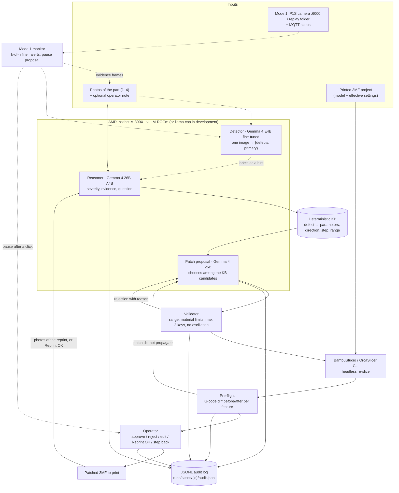

# 03. Architecture

## 1. Guiding principle

**Every parameter PrintLoop can change must have a verifiable signature in the G-code.** A parameter enters the knowledge base only if the pre-flight can check that the change propagated (speed of a feature, E/mm ratio, value of `M106`, `M104`, retraction length). So verification is not an add-on: it decides what the system may touch.

The LLM classifies and explains. The numbers of the patch (ranges, steps, limits) come from the KB and the validator, and the verification from the parser.

## 2. Components

Two models, two modes. **Mode 2** (after the print, implemented) fixes the preset; **Mode 1** (during the print,
planned: [08](08_MODE1_LIVE.md)) watches the camera and feeds Mode 2 with evidence. Dashed: planned.



## 3. Case state machine

| State | Goes to | Condition |
| :-- | :-- | :-- |
| `INTAKE` | `DIAGNOSE` | photos + preset + model uploaded, `--export-settings` succeeded |
| `DIAGNOSE` | `ASK_MORE` | confidence < `PRINTLOOP_MIN_CONFIDENCE`, or class `other` |
| | `DONE` | class `none` or severity ≤ 1 |
| | `PROPOSE` | otherwise |
| `ASK_MORE` | `DIAGNOSE` | new photos or an operator note |
| `PROPOSE` | `VALIDATE` | patch with ≤ 2 keys, all among the KB candidates |
| `VALIDATE` | `SLICE` / `PROPOSE` | OK / rejection with a reason (at most 2 retries, then `ESCALATE`) |
| `SLICE` | `PREFLIGHT` | 3MF produced, G-code extracted |
| `PREFLIGHT` | `APPROVAL` / `PROPOSE` | expected effect visible and no limit exceeded / otherwise |
| `APPROVAL` | `EXPORT` / `PROPOSE` / `ESCALATE` | approve / reject with a reason / stop |
| `EXPORT` | `REEVALUATE` / `DONE` | reprint done, new photos / the operator confirms the reprint is good |
| `REEVALUATE` | `DONE` / `DIAGNOSE` / `ESCALATE` | success / iteration < K / iteration = K |

Every transition writes a line to the audit log (same schema as MarginSwarm: timestamp, state, input hash, output, actor).

**Implemented states** (`loop.py`, [05_API.md](05_API.md) §1): `awaiting_photos`, `ready`, `needs_info`, `diagnosed`, `awaiting_approval`, `escalated`, `done`. On top of the forward transitions:
- **Confirm the reprint** (`confirm_success`): after an approved patch, before a new one is proposed, the operator closes the case as `fixed` in one action, with or without photos of the reprint.
- **Rewind** (`rewind`): any earlier step of any iteration (photos, diagnosis, patch, approval) can be reopened. The backend lists the reachable targets (`rewind_targets`) with what each one discards. Rewinding to the diagnosis also drops the rejections made against it (and recomputes `rejected_keys`); rewinding to the patch does not count as a rejection.
- **Data on rewind:** later iterations and the files of the discarded steps (photos, `attempt_*`/`edit_*` slices) are moved to `runs/cases/<id>/discarded/<stamp>_<target>/` with a snapshot of the previous `case.json`. Nothing is deleted: photos are of physical prints and cannot be recreated. Replaced photos and rejected or re-diagnosed proposals are archived the same way.
- **Delete:** removes the whole case folder, audit log included.

## 4. Contracts

> Design draft. The final contracts are in `src/printloop/models.py` and in [05_API.md](05_API.md) §3 (e.g. `defect` instead of `class`, `before`/`after` instead of `from`/`to`).

### 4.1 Diagnosis (Gemma output, `response_format: json_schema`)

```json
{
  "defects": [
    {
      "class": "stringing",
      "severity": 2,
      "confidence": 0.74,
      "evidence": [{"photo": "side45.jpg", "description": "thin strings between the two towers, upper third"}],
      "location": "between the towers, from half height up"
    }
  ],
  "primary": "stringing",
  "needs_more_info": false,
  "question_for_operator": null
}
```

- `class` is an enum of the taxonomy ([02](02_DATA_STRATEGY.md) §2), `severity` is an integer 0–3, `confidence` is in [0, 1].
- The confidence stated by the model is not calibrated. For the MVP we use it only as a threshold. If time allows, we estimate it with N samples at temperature > 0 and agreement on the class.

### 4.2 Knowledge base entry (`src/printloop/kb/defects.yaml`)

```yaml
stringing:
  candidates:
    - key: nozzle_temperature        # Orca key ⚠️ to confirm on --export-settings
      scope: filament
      direction: down
      step: 5                        # °C per iteration
      bounds: from_filament_range    # the filament's nozzle_temperature_range_low/high
      gcode_check: hotend_setpoint   # M104/M109 after the first layer
    - key: retraction_length
      scope: printer                 # or filament override
      direction: up
      step: 0.2                      # mm
      bounds: [0.2, 2.0]
      gcode_check: retraction_length # G1 E- between travels
  prefer_order: [retraction_length, nozzle_temperature]
```

Each `gcode_check` maps to a pre-flight function (§5). The validator rejects keys without a `gcode_check`.

### 4.3 Patch (Gemma output, then validated)

```json
{
  "changes": [{"key": "retraction_length", "from": 0.2, "to": 0.6, "reason": "stringing with very low retraction compared to the system profile"}],
  "expected_effect": "fewer strings between the towers",
  "alternatives_considered": ["nozzle_temperature -5"],
  "iteration": 1
}
```

Validator rules (deterministic):
1. at most 2 keys, all among the `candidates` of the diagnosed class;
2. direction equal to the KB one, step ≤ `step` × 2;
3. final value within `bounds`, and temperatures within the filament range;
4. **no oscillation**: a key already changed in one direction in the case cannot go back without explicit approval;
5. never actions that raise the risk beyond the limits (temperatures out of range, volumetric flow above `filament_max_volumetric_speed`).

### 4.4 Pre-flight report

```json
{
  "checks": [
    {"check": "retraction_length", "feature": "travel", "before": 0.2, "after": 0.6, "expected": "up", "pass": true}
  ],
  "limits": [
    {"limit": "max_volumetric_speed", "value_after": 14.2, "max": 21.0, "unit": "mm3/s", "pass": true}
  ],
  "side_effects": {"print_time_min": [14.0, 14.3], "filament_g": [6.1, 6.1]},
  "pass": true
}
```

## 5. Pre-flight: what the parser measures

The parser reads the G-code line by line, keeps the state (position, absolute `M82` or relative `M83` E mode, current feedrate, current feature from the comments) and aggregates per feature and per layer:

| `gcode_check` | Measure | Parameters it verifies |
| :-- | :-- | :-- |
| `feature_speed` | median F (mm/s) over the extruding segments of the feature | `bridge_speed`, `outer_wall_speed`, `initial_layer_speed` |
| `extrusion_per_mm` | ΔE / XY distance, per feature | `filament_flow_ratio`, `bridge_flow` |
| `fan_during_feature` | last active `M106 S` during the feature (0–255 scale) | `overhang_fan_speed`, `fan_max_speed` |
| `hotend_setpoint` | `M104`/`M109` after the first layer | `nozzle_temperature` |
| `bed_setpoint` | `M140`/`M190` | bed temperature |
| `retraction_length` | median of the `G1 E-` before travels | `retraction_length` |
| `max_volumetric_speed` (limit) | max of ΔE·π(d/2)² / Δt | all |

Formats verified on real BambuStudio 2.8.2 G-code (spike S2): `; FEATURE: Bridge`, `; CHANGE_LAYER`, a `CONFIG_BLOCK` with all the effective settings (used for the propagation check), `M106 S…` without `P` or with `P1` for the part fan (`P2` auxiliary, `P3` chamber), retraction spread over the wipe, start and end G-code delimited by markers. The parser also accepts `;TYPE:` and `;LAYER_CHANGE` (Prusa/Orca style).

Implementation: effect threshold `MIN_EFFECT` = 25% of the change set, volumetric flow at the length-weighted p99. A limit fails only if the patch makes it worse: if it was already exceeded before, it passes with a note.

## 6. Mode 1 (planned)

Spec: [08_MODE1_LIVE.md](08_MODE1_LIVE.md). It replaces the first draft that sent a frame to the 26B every ~30 s
with a reduced taxonomy: the per-frame model is the fine-tuned **Gemma 4 E4B** ([07](07_VISION_MODEL.md)), one frame
every `interval_s` (default 10 s), through a k-of-n **temporal filter**. Pause is only proposed and sent after a click;
`print.stop` is never sent. Evidence frames become photos of a Mode 2 case.

In Mode 2 the same E4B labels each uploaded photo and the 26B uses the labels as a hint, with disagreement sent to the
operator: [09_MODE2_TWO_MODELS.md](09_MODE2_TWO_MODELS.md).

## 7. API for the frontend

Implemented: FastAPI on **port 8788**, `/api` prefix, contract and states in [05_API.md](05_API.md), real fixtures in `web/fixtures/`.

## 8. Code layout (implemented)

```text
src/printloop/
├── config.py        # .env, thresholds, K, slicer lookup
├── taxonomy.py      # defect classes and rubric
├── kb.yaml · kb.py  # deterministic knowledge base
├── project.py       # settings in the 3MF: reading, format, aliases, writing the patched copy
├── slicer.py        # BambuStudio / OrcaSlicer CLI wrapper
├── gcode.py         # per-feature and per-layer parser
├── preflight.py     # propagation, effect on the toolpath, limits
├── models.py        # pydantic contracts (Case, Diagnosis, Proposal, Preflight, …)
├── llm.py           # OpenAI-compatible client with images (adapted from MarginSwarm)
├── diagnose.py      # Gemma (JSON schema) or operator; planned: E4B labels as a hint + agreement rule (09)
├── propose.py       # rule-based or Gemma proposal, among the filtered candidates
├── validate.py      # deterministic validator
├── loop.py          # state machine, confirm, rewind, cases on disk, JSONL audit
├── live/            # planned, Mode 1: sources, printer (MQTT), detector, policy, monitor (08 §11)
├── api.py · cli.py  # FastAPI :8788 and the `printloop` CLI
├── testset.py       # coupon and cases with induced defects
├── eval.py · bench.py
infra/               # serve_gemma_vision.sh (26B, vLLM MI300X), serve_vision_e4b.sh (E4B detector, llama.cpp), serve_local_llama.sh (Radeon)
finetune/            # separate component: LoRA fine-tuning of the E4B detector (MI300X recipe), not imported by the app
examples/coupon/     # coupon 3MF project (our model, P1S + PLA system presets)
web/fixtures/        # real API replies for the frontend
tests/               # unit + integration with the slicer + faked LLM path
```

Differences from the draft: the input is the **3MF project** (not separate preset JSONs), and the patch is applied by rewriting `Metadata/project_settings.config` in a copy of the 3MF. The slicer is BambuStudio or OrcaSlicer (same CLI).

Choices of the rule-based proposal, beyond the KB order: first the parameters the user changed against the system profile (`different_settings_to_system` in the project), then those already at the end of the range that worsens the defect. In the loop: if severity goes down keep pushing the same parameter, otherwise move to the next one.
