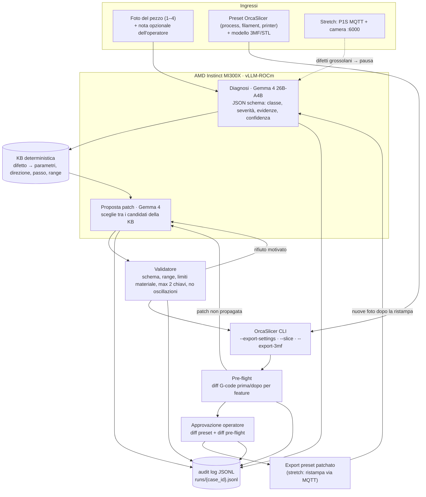

# 03. Architettura

## 1. Principio guida

**Ogni parametro che PrintLoop può modificare deve avere una firma verificabile nel G-code.** Un parametro entra nella knowledge base solo se il pre-flight sa controllare che la modifica si sia propagata (velocità di una feature, rapporto E/mm, valore di `M106`, `M104`, lunghezza di retrazione). Così la verifica non è un'aggiunta: è ciò che decide cosa il sistema può toccare.

L'LLM classifica e motiva. I numeri della patch (range, passi, limiti) vengono dalla KB e dal validatore, e la verifica dal parser.

## 2. Componenti



## 3. Macchina a stati del caso

| Stato | Esce verso | Condizione |
| :-- | :-- | :-- |
| `INTAKE` | `DIAGNOSE` | foto + preset + modello caricati, `--export-settings` riuscito |
| `DIAGNOSE` | `ASK_MORE` | confidenza < `PRINTLOOP_MIN_CONFIDENCE`, oppure classe `other` |
| | `DONE` | classe `none` o severità ≤ 1 |
| | `PROPOSE` | altrimenti |
| `ASK_MORE` | `DIAGNOSE` | nuove foto o nota dell'operatore |
| `PROPOSE` | `VALIDATE` | patch con ≤ 2 chiavi, tutte tra i candidati KB |
| `VALIDATE` | `SLICE` / `PROPOSE` | OK / rifiuto con motivo (max 2 ritentativi, poi `ESCALATE`) |
| `SLICE` | `PREFLIGHT` | 3MF prodotto, G-code estratto |
| `PREFLIGHT` | `APPROVAL` / `PROPOSE` | effetto atteso visibile e nessun limite superato / altrimenti |
| `APPROVAL` | `EXPORT` / `PROPOSE` / `ESCALATE` | approva / rifiuta con motivo / ferma |
| `EXPORT` | `REEVALUATE` | ristampa fatta, nuove foto |
| `REEVALUATE` | `DONE` / `DIAGNOSE` / `ESCALATE` | successo / iterazione < K / iterazione = K |

Ogni transizione scrive una riga nell'audit log (stesso schema di MarginSwarm: timestamp, stato, input hash, output, attore).

## 4. Contratti

> Bozza di progetto. I contratti definitivi sono in `src/printloop/models.py` e in [05_API.md](05_API.md) §3 (es. `defect` invece di `class`, `before`/`after` invece di `from`/`to`).

### 4.1 Diagnosi (output di Gemma, `response_format: json_schema`)

```json
{
  "defects": [
    {
      "class": "stringing",
      "severity": 2,
      "confidence": 0.74,
      "evidence": [{"photo": "side45.jpg", "description": "fili sottili tra le due torri, terzo superiore"}],
      "location": "tra le torri, da metà altezza in su"
    }
  ],
  "primary": "stringing",
  "needs_more_info": false,
  "question_for_operator": null
}
```

- `class` è un enum della tassonomia ([02](02_DATA_STRATEGY.md) §2), `severity` è un intero 0–3, `confidence` è in [0, 1].
- La confidenza dichiarata dal modello non è calibrata. Per l'MVP la usiamo solo come soglia. Se avanza tempo, la stimiamo con N campioni a temperatura > 0 e accordo sulla classe.

### 4.2 Voce della knowledge base (`src/printloop/kb/defects.yaml`)

```yaml
stringing:
  candidates:
    - key: nozzle_temperature        # chiave Orca ⚠️ da confermare su --export-settings
      scope: filament
      direction: down
      step: 5                        # °C per iterazione
      bounds: from_filament_range    # nozzle_temperature_range_low/high del filamento
      gcode_check: hotend_setpoint   # M104/M109 dopo il primo layer
    - key: retraction_length
      scope: printer                 # o override di filamento
      direction: up
      step: 0.2                      # mm
      bounds: [0.2, 2.0]
      gcode_check: retraction_length # G1 E- tra le travel
  prefer_order: [retraction_length, nozzle_temperature]
```

Ogni `gcode_check` corrisponde a una funzione del pre-flight (§5). Il validatore rifiuta le chiavi senza `gcode_check`.

### 4.3 Patch (output di Gemma, poi validata)

```json
{
  "changes": [{"key": "retraction_length", "from": 0.2, "to": 0.6, "reason": "stringing con retrazione molto bassa rispetto al profilo di sistema"}],
  "expected_effect": "meno fili tra le torri",
  "alternatives_considered": ["nozzle_temperature -5"],
  "iteration": 1
}
```

Regole del validatore (deterministiche):
1. massimo 2 chiavi, tutte tra i `candidates` della classe diagnosticata;
2. direzione uguale a quella della KB, passo ≤ `step` × 2;
3. valore finale dentro `bounds`, e temperature dentro il range del filamento;
4. **no oscillazioni**: una chiave già modificata in una direzione nel caso non può tornare indietro senza approvazione esplicita;
5. mai azioni che aumentano il rischio oltre i limiti (temperature fuori range, flusso volumetrico oltre `filament_max_volumetric_speed`).

### 4.4 Report di pre-flight

```json
{
  "checks": [
    {"check": "retraction_length", "feature": "travel", "before": 0.2, "after": 0.6, "expected": "up", "pass": true}
  ],
  "limits": [
    {"limit": "max_volumetric_speed", "value_after": 14.2, "max": 21.0, "unit": "mm3/s", "pass": true}
  ],
  "side_effects": {"print_time_min": [14.0, 14.3], "filament_g": [6.1, 6.1]},
  "pass": true
}
```

## 5. Pre-flight: cosa misura il parser

Il parser legge il G-code riga per riga, tiene lo stato (posizione, modalità E assoluta `M82` o relativa `M83`, feedrate corrente, feature corrente dai commenti) e aggrega per feature e per layer:

| `gcode_check` | Misura | Parametri che verifica |
| :-- | :-- | :-- |
| `feature_speed` | mediana di F (mm/s) sui segmenti estrudenti della feature | `bridge_speed`, `outer_wall_speed`, `initial_layer_speed` |
| `extrusion_per_mm` | ΔE / distanza XY, per feature | `filament_flow_ratio`, `bridge_flow` |
| `fan_during_feature` | ultimo `M106 S` attivo durante la feature (scala 0–255) | `overhang_fan_speed`, `fan_max_speed` |
| `hotend_setpoint` | `M104`/`M109` dopo il primo layer | `nozzle_temperature` |
| `bed_setpoint` | `M140`/`M190` | temperatura del piano |
| `retraction_length` | mediana dei `G1 E-` prima delle travel | `retraction_length` |
| `max_volumetric_speed` (limite) | max di ΔE·π(d/2)² / Δt | tutti |

Formati verificati su G-code reali di BambuStudio 2.8.2 (spike S2): `; FEATURE: Bridge`, `; CHANGE_LAYER`, `CONFIG_BLOCK` con tutte le impostazioni effettive (usato per il controllo di propagazione), `M106 S…` senza `P` o con `P1` per la ventola di parte (`P2` ausiliaria, `P3` camera), retrazione distribuita sul wipe, start ed end G-code delimitati da marcatori. Il parser accetta anche `;TYPE:` e `;LAYER_CHANGE` (stile Prusa/Orca).

Implementazione: soglia di effetto `MIN_EFFECT` = 25% della variazione impostata, flusso volumetrico al p99 pesato per lunghezza. Un limite fallisce solo se la patch lo peggiora: se era già superato prima, passa con avviso.

## 6. Modo 1 (stretch)

- Client MQTT in sola lettura per lo stato (`layer_num`, `mc_percent`, `gcode_state`, temperature) e client camera :6000 che salva un frame ogni N secondi.
- Ogni ~30 s il frame più recente va a Gemma con una tassonomia ridotta (`spaghetti`, `warping`, `layer_shift`, `none`).
- Se trova un difetto con confidenza alta, la UI propone **pausa** e la pausa parte solo dopo un clic. `print.stop` non è mai automatico.
- I frame con il difetto diventano evidenze di un caso Modo 2.

## 7. API per il frontend

Implementata: FastAPI su **porta 8788**, prefisso `/api`, contratto e stati in [05_API.md](05_API.md), fixture reali in `web/fixtures/`.

## 8. Struttura del codice (implementata)

```text
src/printloop/
├── config.py        # .env, soglie, K, ricerca dello slicer
├── taxonomy.py      # classi di difetto e rubrica
├── kb.yaml · kb.py  # knowledge base deterministica
├── project.py       # impostazioni nel 3MF: lettura, formato, alias, scrittura della copia patchata
├── slicer.py        # wrapper CLI BambuStudio / OrcaSlicer
├── gcode.py         # parser per feature e layer
├── preflight.py     # propagazione, effetto sul percorso, limiti
├── models.py        # contratti pydantic (Case, Diagnosis, Proposal, Preflight, …)
├── llm.py           # client OpenAI-compatibile con immagini (ripreso da MarginSwarm)
├── diagnose.py      # Gemma (JSON schema) o operatore
├── propose.py       # proposta a regole o con Gemma, tra i candidati filtrati
├── validate.py      # validatore deterministico
├── loop.py          # macchina a stati, casi su disco, audit JSONL
├── api.py · cli.py  # FastAPI :8788 e CLI `printloop`
├── testset.py       # coupon e casi con difetti indotti
├── eval.py · bench.py
infra/               # serve_gemma_vision.sh (vLLM MI300X), serve_local_llama.sh (Radeon)
examples/coupon/     # progetto 3MF del coupon (nostro modello, preset di sistema P1S + PLA)
web/fixtures/        # risposte API reali per il frontend
tests/               # unitari + integrazione con slicer + percorso LLM simulato
```

Differenze dalla bozza: l'input è il **progetto 3MF** (non preset JSON separati), e la patch si applica riscrivendo `Metadata/project_settings.config` in una copia del 3MF. Lo slicer è BambuStudio o OrcaSlicer (stessa CLI).

Scelte della proposta a regole, oltre all'ordine della KB: prima i parametri che l'utente ha cambiato rispetto al profilo di sistema (`different_settings_to_system` nel progetto), poi quelli già all'estremo del range nella direzione che peggiora il difetto. Nel loop: se la severità scende si insiste sullo stesso parametro, altrimenti si passa al successivo.
