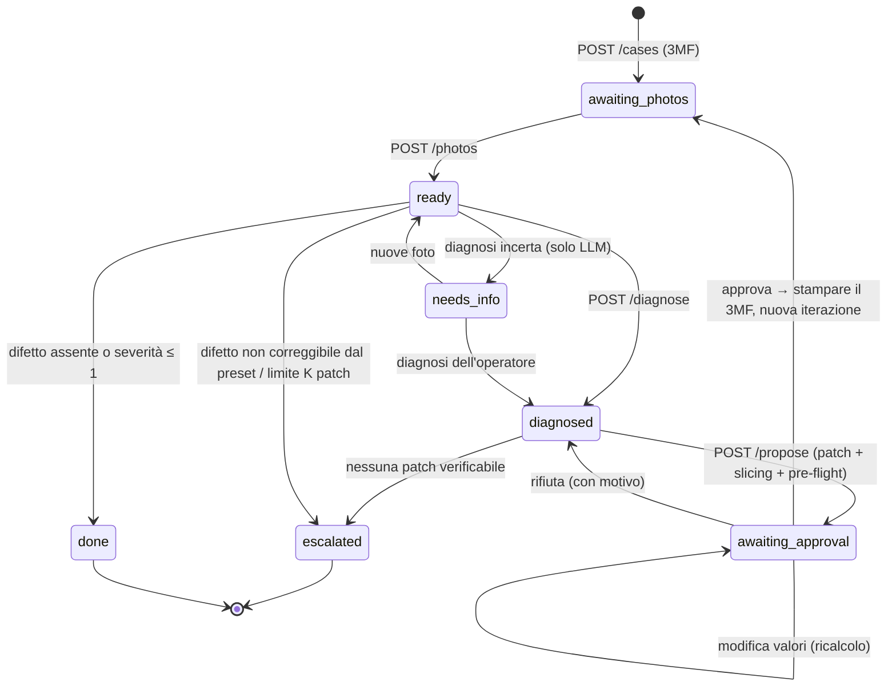

# 05. Contratto API (frontend React/Vite)

- **Base URL:** `http://localhost:8788` (8080 occupata sulla macchina di sviluppo, 8787 usata da MarginSwarm). Documentazione interattiva su `/docs`.
- **Avvio:** `uv run uvicorn printloop.api:app --port 8788 --reload`
- **Fixture:** [`web/fixtures/`](../../web/fixtures/) contiene risposte reali per ogni stato, generate da `scripts/export_fixtures.py`. Il frontend può lavorare su quelle senza backend.
- **CORS** aperto. Errori sempre come `{"detail": "messaggio in italiano"}`.
- **UI:** implementata in [`web/`](../../web/README.md). Con `web/dist` presente (`npm run build`), FastAPI serve anche la UI su `/` con fallback SPA.

## 1. Flusso e stati



Il campo `allowed_actions` di ogni caso dice quali pulsanti mostrare:

| `state` | `allowed_actions` | Cosa mostra la UI |
| :-- | :-- | :-- |
| `awaiting_photos` | `upload_photos`, `diagnose_operator`, `stop` | upload delle foto (della prima stampa o della ristampa) |
| `ready` | `diagnose`, `upload_photos`, `stop` | anteprima foto, pulsante "Analizza" |
| `needs_info` | `upload_photos`, `diagnose`, `stop` | `message` con la domanda del modello; scelta manuale del difetto |
| `diagnosed` | `propose`, `diagnose`, `stop` | diagnosi (classe, severità, evidenze); "Proponi correzione" |
| `awaiting_approval` | `approve`, `reject`, `edit`, `diagnose`, `stop` | **schermata chiave**: diff del preset, pre-flight, effetti su tempo e grammi |
| `escalated` | — | `message` con il motivo (meccanico, limite iterazioni, stop) |
| `done` | — | esito (`fixed` / `no_defect`) e storico delle iterazioni |

Se `llm_mode` è `offline`, la diagnosi va fatta con `mode: "operator"` (l'operatore sceglie il difetto da `/api/taxonomy`).

## 2. Endpoint

| Metodo | Path | Corpo | Risposta |
| :-- | :-- | :-- | :-- |
| `GET` | `/api/health` | — | stato, `llm` (`mode`, `model`), `slicer` (`available`, `version`), telemetria LLM |
| `GET` | `/api/taxonomy` | — | `defects[]` (`id`, `label`, `description`, `fixable`), `severity` (0–3) |
| `GET` | `/api/kb` | — | knowledge base completa (parametri, candidati per difetto) |
| `GET` | `/api/cases` | — | elenco sintetico dei casi |
| `POST` | `/api/cases` | multipart: `project` (.3mf), `name` | **Case** (stato `awaiting_photos`, slicing di riferimento fatto) |
| `GET` | `/api/cases/{id}` | — | **Case** |
| `POST` | `/api/cases/{id}/photos` | multipart: `photos` (1–4 file), `note` | **Case** (`ready`). Sostituisce le foto dell'iterazione corrente |
| `POST` | `/api/cases/{id}/diagnose` | `{"mode": "auto"\|"llm"\|"operator", "defect"?, "severity"?, "note"?}` | **Case** (`diagnosed` / `needs_info` / `done` / `escalated`) |
| `POST` | `/api/cases/{id}/propose` | `{"mode": "auto"\|"llm"\|"rules"}` | **Case** (`awaiting_approval` o `escalated`). Impiega 2–10 s (slicing) |
| `POST` | `/api/cases/{id}/decision` | `{"approved": bool, "reason": str, "edits"?: {chiave: valore}, "stop"?: bool}` | **Case** |
| `GET` | `/api/cases/{id}/audit` | — | righe dell'audit log (JSONL) |
| `GET` | `/api/cases/{id}/files/{path}` | — | foto, 3MF da stampare, G-code |

Regole di `decision`:
- `approved: true`: approva la patch e apre l'iterazione successiva. Se il pre-flight **non** è superato, serve `reason` (override registrato).
- `approved: false` + `reason`: rifiuto. I parametri rifiutati sono esclusi dalle proposte successive del caso.
- `edits`: l'operatore cambia i valori. Il backend rivalida (passo e direzione diventano avvisi, i limiti restano vincolanti), rifà slicing e pre-flight. Con `approved: false` torna in `awaiting_approval` per la conferma, con `approved: true` approva subito se il pre-flight passa.
- `stop: true`: chiude il caso (`escalated`, `outcome: "stopped"`).

Codici di errore: `404` caso o file inesistente · `409` azione non ammessa nello stato, oppure input non valido · `422` validazione della richiesta · `502` errore dello slicer · `503` LLM non raggiungibile.

## 3. Oggetto Case (campi principali)

```jsonc
{
  "id": "13aadac163", "name": "Bridge test", "state": "awaiting_approval",
  "printer": "Bambu Lab P1S 0.4 nozzle", "material": "PLA", "process": "0.20mm Standard @BBL X1C",
  "max_iterations": 3, "outcome": null, "message": "Patch verificata sul G-code: …",
  "allowed_actions": ["approve", "reject", "edit", "diagnose", "stop"],
  "llm_mode": "offline",                         // "llm" quando Gemma è configurato
  "latest_print_file_url": null,                 // ultimo 3MF approvato da stampare
  "edit_options": [                              // solo in awaiting_approval: parametri modificabili dall'operatore
    {"key": "bridge_speed", "label": "Velocità dei bridge", "unit": "mm/s", "step": 20, "direction": "down",
     "min": 10, "max": 100, "current": 100, "proposed": 80}   // limiti già risolti (es. range del filamento)
  ],
  "baseline": {"print_time_s": 703.6, "filament_g": 4.39, "gcode": {…}},
  "rejected_keys": [],
  "iterations": [{
    "n": 1, "photos": ["iter_1/photos/front.jpg"], "photo_urls": ["/api/cases/…/files/iter_1/photos/front.jpg"],
    "note": "i ponti cedono al centro",
    "diagnosis": {
      "primary": "bridge_sagging", "primary_label": "Bridge che cedono", "severity": 3, "confidence": 1.0,
      "source": "operator",                      // "llm": model, latency_ms, evidence con foto citate
      "findings": [{"defect": "bridge_sagging", "severity": 3, "confidence": 1.0,
                    "evidence": [{"photo": "iter_1/photos/front.jpg", "description": "…"}], "location": ""}],
      "needs_more_info": false, "question_for_operator": ""
    },
    "proposal": {
      "source": "rules",                         // "llm" | "rules" | "operator"
      "changes": [{"key": "bridge_speed", "label": "Velocità dei bridge", "unit": "mm/s",
                   "before": 100.0, "after": 80.0, "reason": "…", "real": {"bridge_speed": 80.0}, "companion": false}],
      "rationale": "…", "expected_effect": "…",
      "rejected_attempts": [{"source": "llm", "stage": "validation", "reason": "…", "changes": […]}]
    },
    "validation": {"ok": true, "errors": [], "warnings": []},
    "preflight": {
      "ok": true,
      "checks": [{"check": "config", "key": "bridge_speed", "target": "bridge_speed", "before": 100, "after": 80,
                  "status": "pass", "detail": "valore scritto nel G-code"},
                 {"check": "feature_speed", "target": "Bridge", "before": 100.0, "after": 80.0, "status": "pass",
                  "detail": "-20 (impostato -20)"}],
      "limits": [{"check": "max_volumetric_speed", "after": 20.58, "expected": "≤ 21 mm³/s", "status": "pass"}],
      "side_effects": {"print_time_s": [703.6, 713.9], "filament_g": [4.39, 4.39], "layers": [85, 85]}
    },
    "print_file_url": "/api/cases/…/files/iter_1/attempt_1/slice/sliced.3mf",
    "decision": null,
    "rejected": []                               // proposte rifiutate in questa iterazione, con motivo
  }]
}
```

Suggerimenti per la schermata di approvazione: mostrare `changes` come diff (`label`: `before` → `after` `unit`, con `reason`), i `checks` come lista verde/rossa (`detail` è già leggibile), `side_effects` come "+10 s, +0 g", gli eventuali `rejected_attempts` ("tentativi scartati dal sistema") e `validation.warnings`. Le modifiche dell'operatore (`edits`) usano le `key` della KB (`/api/kb` → `params` per label, unità, limiti e passo).
