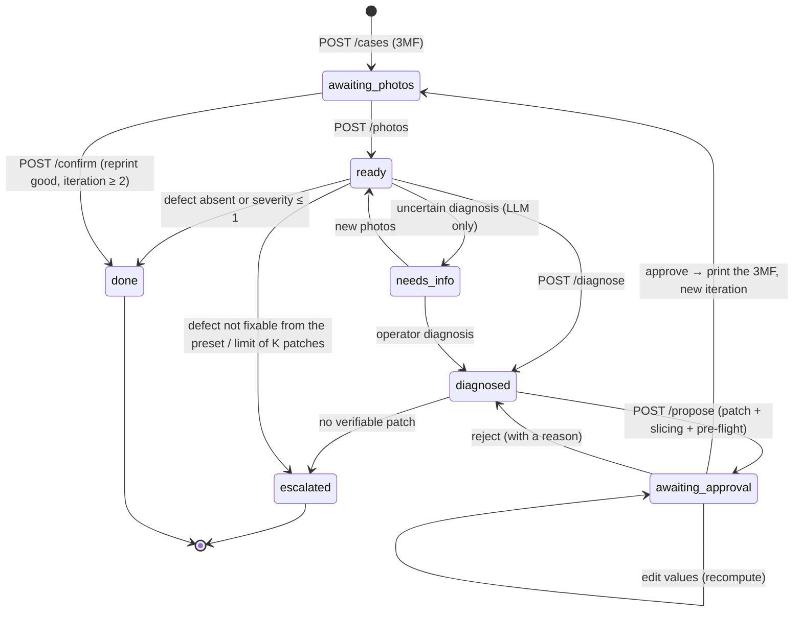

# 05. API contract (React/Vite frontend)

- **Base URL:** `http://localhost:8788` (8080 is taken on the development machine, 8787 is used by MarginSwarm). Interactive docs at `/docs`.
- **Start:** `uv run uvicorn printloop.api:app --port 8788 --reload`
- **Fixtures:** [`web/fixtures/`](../../web/fixtures/) holds real replies for every state, generated by `scripts/export_fixtures.py`. The frontend can work on them without a backend.
- **CORS** open. Errors always come as `{"detail": "message"}`, in English.
- **UI:** implemented in [`web/`](../../web/README.md). When `web/dist` exists (`npm run build`), FastAPI also serves the UI on `/` with SPA fallback.

## 1. Flow and states



On top of these, **`POST /rewind`** goes back from any state (closed ones included) to an earlier step of any iteration: see §2.

The `allowed_actions` field of each case says which buttons to show:

| `state` | `allowed_actions` | What the UI shows |
| :-- | :-- | :-- |
| `awaiting_photos` | `upload_photos`, `diagnose_operator`, `stop` (+ `confirm_success` from iteration 2) | upload of the photos (of the first print or of the reprint); "Reprint OK" |
| `ready` | `diagnose`, `upload_photos`, `stop` (+ `confirm_success`) | photo preview, "Analyse" button |
| `needs_info` | `upload_photos`, `diagnose`, `stop` (+ `confirm_success`) | `message` with the model's question; manual defect choice |
| `diagnosed` | `propose`, `diagnose`, `stop` (+ `confirm_success`) | diagnosis (class, severity, evidence); "Propose a patch" |
| `awaiting_approval` | `approve`, `reject`, `edit`, `diagnose`, `stop` | **key screen**: preset diff, pre-flight, effect on time and grams |
| `escalated` | — | `message` with the reason (mechanical, iteration limit, stop) |
| `done` | — | outcome (`fixed` / `no_defect`) and iteration history |

`rewind` is added whenever `rewind_targets` is not empty; `delete` is always allowed and not listed. If `llm_mode` is `offline`, the diagnosis is done with `mode: "operator"` (the operator picks the defect from `/api/taxonomy`; the UI does not offer `none` there, a good reprint is closed with `confirm`).

## 2. Endpoints

| Method | Path | Body | Response |
| :-- | :-- | :-- | :-- |
| `GET` | `/api/health` | — | status, `llm` (`mode`, `model`), `slicer` (`available`, `version`), LLM telemetry |
| `GET` | `/api/taxonomy` | — | `defects[]` (`id`, `label`, `description`, `fixable`), `severity` (0–3) |
| `GET` | `/api/kb` | — | full knowledge base (parameters, candidates per defect) |
| `GET` | `/api/cases` | — | case summaries, each with `allowed_actions` (the list shows "Reprint OK" from it) |
| `POST` | `/api/cases` | multipart: `project` (.3mf), `name` | **Case** (state `awaiting_photos`, reference slice done) |
| `GET` | `/api/cases/{id}` | — | **Case** |
| `DELETE` | `/api/cases/{id}` | — | `{"deleted": id}`. Removes the whole case folder (photos, 3MF, G-code, audit) |
| `POST` | `/api/cases/{id}/photos` | multipart: `photos` (1–4 files), `note` | **Case** (`ready`). Replaces the photos of the current iteration (the old ones are archived) |
| `POST` | `/api/cases/{id}/diagnose` | `{"mode": "auto"\|"llm"\|"operator", "defect"?, "severity"?, "note"?}` | **Case** (`diagnosed` / `needs_info` / `done` / `escalated`) |
| `POST` | `/api/cases/{id}/propose` | `{"mode": "auto"\|"llm"\|"rules"}` | **Case** (`awaiting_approval` or `escalated`). Takes 2–10 s (slicing) |
| `POST` | `/api/cases/{id}/decision` | `{"approved": bool, "reason": str, "edits"?: {key: value}, "stop"?: bool}` | **Case** |
| `POST` | `/api/cases/{id}/confirm` | `{"note"?: str}` | **Case** (`done`, `outcome: "fixed"`). Only with `confirm_success` in `allowed_actions` |
| `POST` | `/api/cases/{id}/rewind` | `{"iteration": int, "step": "photos"\|"diagnosis"\|"patch"\|"approval"}` | **Case** in the state that waits for that step. Only for an entry of `rewind_targets` |
| `GET` | `/api/cases/{id}/audit` | — | rows of the audit log (JSONL) |
| `GET` | `/api/cases/{id}/files/{path}` | — | photos, 3MF to print, G-code |

`decision` rules:
- `approved: true`: approves the patch and opens the next iteration. If the pre-flight did **not** pass, a `reason` is required (recorded override).
- `approved: false` + `reason`: rejection. The rejected parameters are excluded from the case's later proposals.
- `edits`: the operator changes the values. The backend revalidates (step and direction become warnings, bounds stay binding), re-slices and reruns the pre-flight. With `approved: false` it goes back to `awaiting_approval` for confirmation, with `approved: true` it approves right away if the pre-flight passes.
- `stop: true`: closes the case (`escalated`, `outcome: "stopped"`).

`confirm` rules: allowed from iteration 2 (a patch was approved and printed) in `awaiting_photos`, `ready`, `needs_info` and `diagnosed`, i.e. before a new patch is proposed. Photos of the reprint are optional. The iteration gets `confirmed` (`note`, `actor`, `at`).

`rewind` rules:
- The step names the state the case returns to: `photos` → `awaiting_photos`, `diagnosis` → `ready` (or `awaiting_photos` without photos), `patch` → `diagnosed`, `approval` → `awaiting_approval`.
- Everything after the target is discarded: later iterations, and in the target iteration the steps from the target on (`photos` also clears photos and note; `diagnosis` also clears the rejections made against it, and `rejected_keys` is recomputed; `patch` clears the proposal without counting it as a rejection; `approval` clears only the decision).
- Discarded files are **moved, not deleted**, to `runs/cases/<id>/discarded/<stamp>_rewind_iter<n>_<step>/`, together with the previous `case.json`. The audit log gets a `rewound` event with the target, what was discarded and the archive folder.

Error codes: `404` missing case or file · `409` action not allowed in the state, or invalid input · `422` request validation · `502` slicer error · `503` LLM unreachable.

## 3. Case object (main fields)

```jsonc
{
  "id": "13aadac163", "name": "Bridge test", "state": "awaiting_approval",
  "printer": "Bambu Lab P1S 0.4 nozzle", "material": "PLA", "process": "0.20mm Standard @BBL X1C",
  "max_iterations": 3, "outcome": null, "message": "Patch verified on the G-code: …",
  "allowed_actions": ["approve", "reject", "edit", "diagnose", "stop", "rewind"],
  "rewind_targets": [                            // oldest first: the last one is "one step back"
    {"iteration": 1, "step": "photos", "discards": ["1 photo of iteration 1", "the diagnosis of iteration 1", "the patch of iteration 1"]},
    {"iteration": 1, "step": "diagnosis", "discards": ["the diagnosis of iteration 1", "the patch of iteration 1"]},
    {"iteration": 1, "step": "patch", "discards": ["the patch of iteration 1"]}
  ],
  "llm_mode": "offline",                         // "llm" when Gemma is configured
  "latest_print_file_url": null,                 // last approved 3MF to print
  "edit_options": [                              // only in awaiting_approval: parameters the operator can edit
    {"key": "bridge_speed", "label": "Bridge speed", "unit": "mm/s", "step": 20, "direction": "down",
     "min": 10, "max": 100, "current": 100, "proposed": 80}   // bounds already resolved (e.g. filament range)
  ],
  "baseline": {"print_time_s": 703.6, "filament_g": 4.39, "gcode": {…}},
  "rejected_keys": [],
  "iterations": [{
    "n": 1, "photos": ["iter_1/photos/front.jpg"], "photo_urls": ["/api/cases/…/files/iter_1/photos/front.jpg"],
    "note": "the bridges sag in the middle",
    "diagnosis": {
      "primary": "bridge_sagging", "primary_label": "Sagging bridges", "severity": 3, "confidence": 1.0,
      "source": "operator",                      // "llm": model, latency_ms, evidence citing the photos
      "findings": [{"defect": "bridge_sagging", "severity": 3, "confidence": 1.0,
                    "evidence": [{"photo": "iter_1/photos/front.jpg", "description": "…"}], "location": ""}],
      "needs_more_info": false, "question_for_operator": ""
    },
    "proposal": {
      "source": "rules",                         // "llm" | "rules" | "operator"
      "changes": [{"key": "bridge_speed", "label": "Bridge speed", "unit": "mm/s",
                   "before": 100.0, "after": 80.0, "reason": "…", "real": {"bridge_speed": 80.0}, "companion": false}],
      "rationale": "…", "expected_effect": "…",
      "rejected_attempts": [{"source": "llm", "stage": "validation", "reason": "…", "changes": […]}]
    },
    "validation": {"ok": true, "errors": [], "warnings": []},
    "preflight": {
      "ok": true,
      "checks": [{"check": "config", "key": "bridge_speed", "target": "bridge_speed", "before": 100, "after": 80,
                  "status": "pass", "detail": "value written in the G-code"},
                 {"check": "feature_speed", "target": "Bridge", "before": 100.0, "after": 80.0, "status": "pass",
                  "detail": "-20 (set -20)"}],
      "limits": [{"check": "max_volumetric_speed", "after": 20.58, "expected": "≤ 21 mm³/s", "status": "pass"}],
      "side_effects": {"print_time_s": [703.6, 713.9], "filament_g": [4.39, 4.39], "layers": [85, 85]}
    },
    "print_file_url": "/api/cases/…/files/iter_1/attempt_1/slice/sliced.3mf",
    "decision": null,
    "rejected": [],                              // proposals rejected in this iteration, with the reason
    "confirmed": null                            // {"note", "actor", "at"} once the reprint is confirmed good
  }]
}
```

Hints for the approval screen: show `changes` as a diff (`label`: `before` → `after` `unit`, with `reason`), the `checks` as a green/red list (`detail` is already readable), `side_effects` as "+10 s, +0 g", any `rejected_attempts` ("attempts discarded by the system") and `validation.warnings`. Operator edits (`edits`) use the KB `key`s (`/api/kb` → `params` for label, unit, bounds and step).

## 4. Planned (not implemented yet)

These additions are specified but not in the code. The frontend can build on them with hand-written fixtures; the
backend will match these shapes.

**Mode 1, live monitoring** ([08_MODE1_LIVE.md](08_MODE1_LIVE.md) §8, full session object there):

| Method | Path | Body | Response |
| :-- | :-- | :-- | :-- |
| `GET` | `/api/live` | — | current session or `null`; poll every 2 s while running |
| `POST` | `/api/live/start` | `{"source": "replay"\|"p1s"\|"url", "replay_dir"?, "url"?, "interval_s"?, "case_id"?, "record_all"?}` | session |
| `POST` | `/api/live/stop` | — | session |
| `POST` | `/api/live/alerts/{alert_id}/dismiss` | `{"reason"?}` | session |
| `POST` | `/api/live/pause` | `{"alert_id"?}` | session; `print.pause` over MQTT, only after the operator's click |
| `POST` | `/api/live/attach` | `{"case_id"?, "frames"?}` | **Case** with the evidence frames as photos of its current iteration |
| `GET` | `/api/live/sessions` · `/api/live/sessions/{id}` | — | past sessions |
| `DELETE` | `/api/live/sessions/{id}` | — | `{"deleted": id}` |
| `GET` | `/api/live/frames/{session_id}/{frame_id}` | — | JPEG |

**Mode 2 with two models** ([09_MODE2_TWO_MODELS.md](09_MODE2_TWO_MODELS.md) §6):

- `iterations[].detections[]`: `{photo, defects, primary, model, latency_ms, error}`, one per photo, filled by
  `POST /photos` (best effort).
- `iterations[].diagnosis.detector`: `{defects, primary, agreement: "agree"|"disagree"|"unavailable"}`. A
  disagreement sets `needs_more_info` and the case goes to `needs_info` with both candidates in `message`.
- `GET /api/health`: `vision_llm` (`mode`, `model`, `base_url`) next to `llm`.
- `GET /api/taxonomy` and `DefectClass`: two new classes, `layer_separation` and `blobs`.
