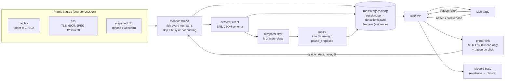

# 08. Mode 1: live monitoring (implementation spec)

> Written on 18 Oct 2026. Status: **designed, not implemented.** This is the spec to build Mode 1 from.
> The detector model (contract, prompt, results, serving) is in [07_VISION_MODEL.md](07_VISION_MODEL.md); this
> document covers everything around it. Plan and cut lines for today: [04](04_PLAN_DECISIONS_RISKS.md) §3.

---

## 0. In one paragraph

The operator starts a **live session** on a running print. Every `interval_s` seconds the monitor takes the latest
camera frame, sends it to the fine-tuned **Gemma 4 E4B** detector (one frame → `{"defects", "primary"}`), and runs the
answers through a **temporal filter**: one frame never triggers anything, a class that persists for k of the last n
frames raises an **alert** or a **proposed pause**. A pause is sent to the printer only after the operator clicks.
Frames that show a defect are kept as **evidence** and can become the photos of a Mode 2 case, so the session ends
with a fix for the next print, not just an alarm.

| Priority | Scope |
| :-- | :-- |
| **P0** | replay frame source, detector client, temporal filter and policy, session on disk, `/api/live*`, Live page, `printloop live` CLI (replay + report) |
| **P1** | P1S camera source (TLS :6000), MQTT read-only status (layer, %, state), linking a session to a Mode 2 case |
| **P2** | `print.pause` over MQTT after a click, new Mode 2 case from a session, snapshot-URL source, logprob confidence |

---

## 1. Components



One monitor at a time (one printer). It runs as a **background thread inside the FastAPI process**, started and
stopped through the API: one process for the demo, like the rest of PrintLoop. Everything it produces is written to
disk, so a restart loses the running session but not its history.

---

## 2. Frame sources

All sources implement the same small interface: `latest() -> Frame | None` with `Frame(jpeg: bytes, taken_at, id)`,
where `id` is the sha1 of the JPEG. The monitor never queues frames: it asks for the latest one on each tick.

### 2.1 `replay` (P0)

A folder of JPEGs played in file-name order, one frame per tick (or at the frame rate in `session.json`). It makes
Mode 1 independent of the printer: development, tests, threshold tuning and a demo that does not depend on the
venue network.

- From a video: `ffmpeg -i print.mp4 -vf fps=1 frames/%05d.jpg`.
- **Demo material without a printer:** the `nimbus200` dataset (Apache-2.0, 151 fixed-camera recordings of real
  prints, some ending in spaghetti) is split **by recording** in the fine-tuning build, so a recording from the
  **test split** (`finetune/data/processed/v1/test.jsonl`, `group` field) was never seen in training. Check the frame
  order inside a recording (file names / timestamps) before using it ⚠️. Frames are 256×256: fine for the detector,
  small in the UI. Cite the dataset in the demo.
- Real P1S recordings (made with the `p1s` source and `record_all`, §6) are the better material as soon as they
  exist.

### 2.2 `p1s` (P1)

Chamber camera of the P1S, LAN-only + Developer Mode ([01_RESEARCH_STACK](01_RESEARCH_STACK.md) §2.1, §2.3):

- TLS socket to `PRINTER_IP:6000`. The printer uses a self-signed certificate: certificate verification is off for
  this LAN connection (this is not an authentication bypass: the access code is still required).
- Authentication: one 80-byte packet = 16-byte header (`u32 LE 0x40`, `u32 LE 0x3000`, `u32 0`, `u32 0`) + user
  `bblp` padded with zeros to 32 bytes + access code padded to 32 bytes. ⚠️ Layout from OpenBambuAPI `video.md`
  and the Home Assistant integration: verify on the printer.
- Then a stream of frames: a 16-byte header whose first `u32 LE` is the payload size, followed by a JPEG
  (`FF D8 … FF D9`). Read the size, read exactly that many bytes, check the JPEG markers, keep only the newest.
- A reader thread keeps the socket open and overwrites one "latest frame" slot; reconnect with back-off on errors.
- ~0.5–1 fps: any `interval_s` ≥ 2 s always gets a fresh frame. If the frame id did not change since the last tick,
  skip the inference (§3).

### 2.3 `url` (P2)

`GET` on a URL that returns one JPEG (phone IP-webcam apps, OctoPrint/go2rtc snapshot endpoints). It is a fallback
when the P1S camera is unreachable but a phone can point at the printer.

---

## 3. Monitor loop

```text
every interval_s:
  if a detector call is still running        -> skip this tick (never pile up requests)
  if printer state is known and not RUNNING  -> skip (PAUSE, FINISH, FAILED, IDLE); FINISH/FAILED end the session
  frame = source.latest()
  if frame is None or frame.id == last.id    -> skip (no new information)
  answer = detector(frame)                   -> LiveDetection (or an error row; errors are not frames for the filter)
  alerts = policy(filter.update(answer, context))
  persist detection row, evidence frames of new/updated alerts, session state
```

- `interval_s`: operator setting, default 10 s, minimum 2 s (one Q8_0 E4B answers in ~0.75 s on a datacenter GPU).
- **Printer context** (P1, from MQTT `push_status`): `gcode_state`, `layer_num`, `total_layer_num`, `mc_percent`,
  `subtask_name`. Without MQTT the context is empty: the session runs until stopped and layer gating (§4) is off.
- The monitor does **not** take the API lock (`api._lock`) or the case lock (`loop._LOCK`): slicing can hold them for
  10 s. It only touches cases when the operator attaches the evidence (§7), through the normal API path.

---

## 4. Detector client

The request is exactly the one in [07](07_VISION_MODEL.md) §3 (system prompt `m1-v1`, image first, then `Inspect
this frame.`, temperature 0, `max_tokens` 64, the JSON schema, thinking off). Differences from the Mode 2 client:

| | Mode 2 (`llm.chat_json` today) | Mode 1 detector |
| :-- | :-- | :-- |
| Endpoint | `LLM_*` | `VISION_LLM_*` (§9) |
| Timeout | 300 s | 15 s: a late answer is a useless answer |
| On error | retries once without the schema | no retry: the next tick is the retry |
| Telemetry | `llm.TELEMETRY` | its own counters (otherwise Mode 1 floods the Mode 2 latency figures in `/api/health`) |
| Image | resized to ≤ 1536 px, JPEG q85 | sent as captured (1280×720 is already below the limit) |

The prompt strings must stay byte-identical to `finetune/src/fdmft/prompt.py`. The app must not import `finetune/`
(separate component): copy the strings into the app with `PROMPT_VERSION = "m1-v1"` and a unit test that compares
them with `finetune/src/fdmft/prompt.py` when that file is present.

---

## 5. Temporal filter and policy

### 5.1 Why a filter

On clean frames the detector says "defect" 5–15% of the time ([07](07_VISION_MODEL.md) §5.2, §5.4), and on the P1S
chamber camera (not in the training data) the rate is unknown. Over a 2-hour print at 10 s there are ~720 frames.
With independent errors at p = 0.15, "3 of the last 4" fires by chance on ~1.2% of the windows, which is **several
false pause proposals per print**. At p = 0.05 it drops to ~0.3 per print. Errors on a static scene are also
correlated (the same frame looks the same), which makes it worse. So the thresholds below are starting values to be
tuned on recorded prints (§10), and pause proposals are always confirmed by a human.

### 5.2 Rules (defaults, all in config)

| Class group | Raise when | Level | Action |
| :-- | :-- | :-- | :-- |
| `spaghetti`, `warping`, `layer_shift`, `other` (blob of death) | 3 of the last 4 frames | `pause_proposed` | UI banner + "Pause print" button (P2: sends `print.pause` after the click) |
| `layer_separation`, `stringing`, `blobs`, `under_extrusion`, `over_extrusion`, `first_layer` | 4 of the last 6 frames | `warning` | UI alert, evidence kept, suggest a Mode 2 case after the print |
| `bridge_sagging`, `overhang_curling` | never | `info` | logged only: no training data ([07](07_VISION_MODEL.md) §9) |

- An alert **clears** after 6 consecutive frames without its class (`cleared_at` set, the alert stays in the list).
- A cleared alert that comes back is a new alert.
- **Layer gating** (only with MQTT context): `first_layer` counts only while `layer_num` ≤ 2; `stringing` and
  `layer_shift` are ignored while `layer_num` < 3 (nothing tall enough to show them).
- **Evidence:** for each alert keep the frames that raised it (at most 4) plus the most recent positive frame.
- `print.stop` is never sent. `print.pause` is sent only from `POST /api/live/pause`, i.e. after a click.

---

## 6. Session on disk

```text
runs/live/<session_id>/
├── session.json        # settings (source, interval, thresholds), status, printer context, linked case, alerts
├── detections.jsonl    # one row per inference: frame id, time, layer, defects, primary, latency, raw answer, error
└── frames/<frame_id>.jpg
```

- `frames/` holds the **evidence frames** and the latest frame. With `record_all: true` it holds every inferred frame:
  that is how real P1S recordings for evaluation and for the next fine-tuning round are collected (~150 KB per
  1280×720 frame, ~110 MB per 2-hour print at 10 s).
- Sessions are deleted like cases (`DELETE /api/live/sessions/{id}`); nothing else removes them.

---

## 7. Link with Mode 2

A Mode 2 case needs the **printed 3MF** (`POST /api/cases`). A live session does not have it. Two paths:

1. **The print is the reprint of a case** (P1, the main path). When the operator starts a session they can pick a
   case in `awaiting_photos` from iteration 2 on (the patch was approved, the reprint is running). At the end:
   - alerts → "Use evidence as reprint photos": up to 4 evidence frames are uploaded to the case's current
     iteration with the normal photo upload; the case continues with the diagnosis as usual;
   - print finished with **no alert ever raised** → the Live page suggests "Reprint OK" on the linked case. The
     operator clicks; nothing closes automatically.
2. **A print not linked to a case** (P2): "Create a case from this session" opens the new-case form (the operator
   uploads the 3MF), then the evidence frames are uploaded as the photos of iteration 1. Fetching the 3MF from the
   printer SD card over FTPS is out of scope.

Chamber frames are wide shots, not close-ups: they are valid evidence, but the operator can still replace them with
phone photos before the diagnosis.

---

## 8. API (planned)

| Method | Path | Body | Result |
| :-- | :-- | :-- | :-- |
| `GET` | `/api/live` | — | current session (or `null`), detector and printer link status |
| `POST` | `/api/live/start` | `{"source": "replay"\|"p1s"\|"url", "replay_dir"?, "url"?, "interval_s"?, "case_id"?, "record_all"?}` | session (`running`); `409` if one is already running or the source is not configured |
| `POST` | `/api/live/stop` | — | session (`stopped`) |
| `POST` | `/api/live/alerts/{alert_id}/dismiss` | `{"reason"?}` | session. The class can raise again later |
| `POST` | `/api/live/pause` | `{"alert_id"?}` | session. Sends `print.pause` (P2); `409` without a printer link |
| `POST` | `/api/live/attach` | `{"case_id"?, "frames"?: [frame_id]}` | **Case**: evidence frames uploaded as photos of its current iteration |
| `GET` | `/api/live/sessions` | — | past sessions (id, start, end, source, alerts, linked case) |
| `GET` | `/api/live/sessions/{id}` | — | session with its detections (`?detections=1`) |
| `DELETE` | `/api/live/sessions/{id}` | — | `{"deleted": id}` |
| `GET` | `/api/live/frames/{session_id}/{frame_id}` | — | JPEG |

Session object:

```jsonc
{
  "id": "20261018-0912-ab12", "status": "running",            // running | stopped | finished | error
  "source": {"kind": "replay", "detail": "data/live/nimbus_test_017"},
  "interval_s": 10, "record_all": false, "case_id": "639f6af432",
  "started_at": "…", "ended_at": null,
  "printer": {"linked": false, "gcode_state": null, "layer_num": null, "total_layer_num": null, "progress": null},
  "detector": {"model": "printloop-vision-e4b", "calls": 42, "errors": 0, "latency_p50_ms": 760},
  "last": {"frame_id": "…", "frame_url": "/api/live/frames/…", "taken_at": "…",
           "defects": ["stringing"], "primary": "stringing", "latency_ms": 742},
  "alerts": [{"id": "a1", "defect": "spaghetti", "level": "pause_proposed", "since": "…", "cleared_at": null,
              "frames": ["…"], "frame_urls": ["…"], "dismissed": false}],
  "counts": {"frames": 42, "skipped": 3, "positives": {"stringing": 5, "spaghetti": 3}}
}
```

The UI polls `GET /api/live` every 2 s while a session runs (no WebSocket needed at one frame per 10 s).

---

## 9. Configuration (planned `.env` keys)

```bash
# Detector: fine-tuned Gemma 4 E4B, OpenAI-compatible (llama-server or vLLM). Shared with Mode 2 (09_MODE2_TWO_MODELS.md).
VISION_LLM_BASE_URL=http://localhost:8082/v1     # infra/serve_vision_e4b.sh (port 8082); vLLM on MI300X: :8001
VISION_LLM_MODEL=printloop-vision-e4b            # alias of serve_vision_e4b.sh / vLLM; router preset: Gemma-4-E4B-3dPrint-v1-Q8
VISION_LLM_API_KEY=
VISION_LLM_TIMEOUT_S=15

# Mode 1
MODE1_SOURCE=replay              # replay | p1s | url
MODE1_REPLAY_DIR=data/live/demo  # folder of JPEGs
MODE1_SNAPSHOT_URL=
MODE1_INTERVAL_S=10
MODE1_PAUSE_K=3
MODE1_PAUSE_N=4
MODE1_ALERT_K=4
MODE1_ALERT_N=6
MODE1_CLEAR_N=6
MODE1_RECORD_ALL=false
# Printer (already in .env.example): PRINTER_IP, PRINTER_SERIAL, PRINTER_ACCESS_CODE
```

**One GPU, two models.** If `VISION_LLM_*` and `LLM_*` point at the same llama.cpp router with one model loaded at a
time, every Mode 1 tick evicts the 26B and every Mode 2 diagnosis evicts the E4B (tens of seconds per swap). Give the
detector its own server (`infra/serve_vision_e4b.sh`, ~10 GB VRAM in Q8_0) or run both on the MI300X ([07](07_VISION_MODEL.md)
§6.3). `/api/health` should warn when both base URLs and the router are the same.

---

## 10. Evaluation before trusting it on a printer

1. Record prints with `record_all` (normal prints and the induced-defect coupons of
   [02_DATA_STRATEGY](02_DATA_STRATEGY.md) §3), and label a sample of frames (`frame_id,defects` CSV).
2. `printloop live replay <dir> --report` runs the full pipeline (detector + filter + policy) on a recorded folder
   without the UI and prints: per-frame accuracy against the labels, alerts raised, **false alerts per print**, and
   **time to alert** (from the first labelled defective frame to the alert).
3. Tune k/n per group on those numbers; record the chosen values in [04](04_PLAN_DECISIONS_RISKS.md).
4. Optional confidence (P2): request `logprobs` and use the probability of the first token of `primary`, calibrated
   on the same frames.

---

## 11. Code layout (planned)

```text
src/printloop/live/
├── sources.py     # Frame, ReplaySource, P1SCameraSource, SnapshotSource
├── printer.py     # MQTT read-only status + pause (paho-mqtt, TLS, self-signed printer certificate)
├── detector.py    # m1-v1 prompt and schema, client on VISION_LLM_*, own telemetry
├── policy.py      # sliding windows, alert levels, clearing, layer gating (pure functions: easy to test)
└── monitor.py     # thread, ticks, session on disk, attach to case
```

Plus: `models.py` (`LiveDetection`, `LiveAlert`, `LiveSession`), `config.py` (`VisionLLMConfig`, `Mode1Config`),
`api.py` (`/api/live*`), `cli.py` (`printloop live start|replay`), `web/src/pages/LivePage.tsx` and a "Live" link in
the top bar. New dependency for P1/P2: `paho-mqtt`.

Tests (no network): policy with scripted answer sequences (raise, clear, gating, dismiss); replay source order;
P1S frame parser on synthetic bytes (header + JPEG, split reads); monitor with a fake detector (skip when busy,
skip on same frame, errors do not count as frames); API start/stop/attach on a replay folder.

## 12. Limits

- The detector has never seen the P1S chamber camera: accuracy and false alerts there are **unmeasured** until §10 is done.
- One image per request: no temporal reasoning inside the model (the filter does that part).
- `bridge_sagging` and `overhang_curling` are not detected.
- The P1S camera protocol and MQTT are reverse-engineered by the community ([01](01_RESEARCH_STACK.md) §2): they can
  change with a firmware update. Developer Mode disables Bambu Handy and cloud printing while it is on.
