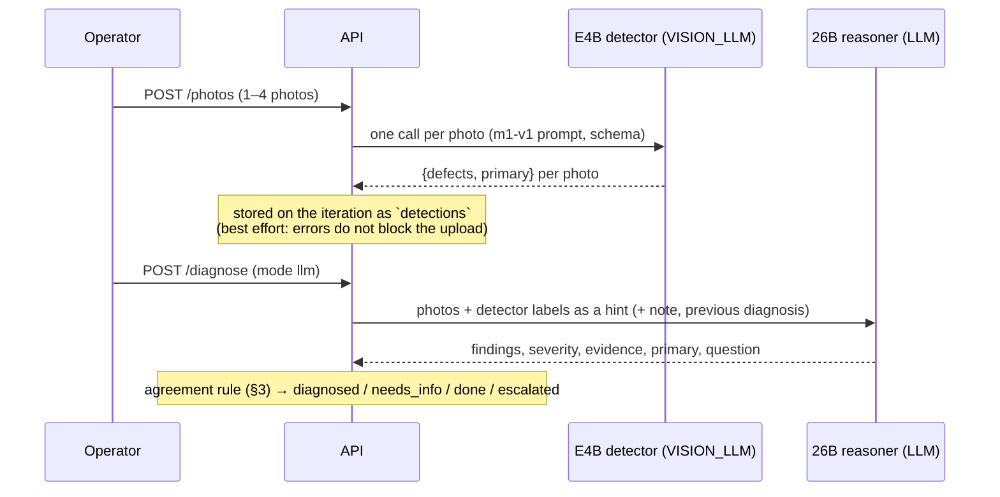

# 09. Mode 2 with two models: E4B detects, 26B reasons (implementation spec)

> Written on 18 Oct 2026. Status: **designed, not implemented.** Chosen option: **B with the disagreement rule of C**
> from [07_VISION_MODEL.md](07_VISION_MODEL.md) §8. Plan and cut lines for today: [04](04_PLAN_DECISIONS_RISKS.md) §3.

---

## 0. Why

| | Gemma 4 26B-A4B (today's Mode 2 model) | Gemma 4 E4B fine-tuned |
| :-- | :-- | :-- |
| Naming the defect on an image | **24.5%** primary class (stock, Q3) | **88.5%** (GGUF Q8_0), 93.0% (PyTorch), same 200 images |
| False positives on clean images | 52.6% | 5.3% |
| Severity 0–3, evidence text, question to the operator | ✅ | ❌ |
| Reasoning about the project, the history and the patch | ✅ | ❌ |
| Latency per image | 2.6 s (llama.cpp, one image) | 0.73 s |

Numbers from [07](07_VISION_MODEL.md) §5.4: one image per call, the short Mode 1 prompt, images from the fine-tuning
sources (not the PrintLoop test set). They justify the change; they do **not** measure Mode 2 on PrintLoop photos (§8).

So each model does what it is good at: the **E4B names the defects** on each photo, the **26B** sees the photos and
those labels, and assigns **severity, evidence and the question** to the operator. When the two disagree, the case
asks the operator instead of guessing.

---

## 1. Pipeline



- **Detection runs at photo upload**, not at diagnosis: it is cheap (~0.75 s per photo), the result is cached on the
  iteration, and it is also useful when the 26B is not available (§5). Replacing photos recomputes it; rewinding to
  the photos discards it together with the photos.
- Detector errors or timeouts never block the upload: the iteration records `detector: unavailable` and the
  diagnosis falls back to today's behaviour.
- Aggregation over the photos: `defects` = union in the canonical order of [07](07_VISION_MODEL.md) §3.1, `primary` =
  first of the union (the most urgent in Mode 1 order). It is only a hint: the 26B picks the Mode 2 primary.

---

## 2. The 26B prompt

The system prompt of `diagnose.py` stays as it is (the two new classes enter through `taxonomy.DEFECTS`). The user
message gets one more text block after the context and before the photos:

```text
A defect classifier fine-tuned on FDM print photos labelled each photo:
- front.jpg: stringing
- side45.jpg: stringing, blobs
- top.jpg: no defect
It names defects well but cannot judge severity or cause. Use it as a strong hint: confirm each label against the
photos, report the defects you can actually see, and assign severity and evidence yourself.
```

Risk: the 26B may copy the hint without looking. That is acceptable only if the evaluation (§8) shows that B is at
least as good as A on PrintLoop photos; the evidence text still has to cite what is visible in each photo.

---

## 3. Agreement rule

`D` = union of the detector's defects over the photos, `P` = the 26B primary.

| Detector | 26B | Agreement | Effect |
| :-- | :-- | :-- | :-- |
| `D` empty (no defect on any photo) | `none` or severity ≤ 1 | `agree` | as today: `done` |
| `D` empty | a defect with severity ≥ 2 | `disagree` | `needs_info`: "The detector saw no defect, the inspector reports *P*. Confirm the defect or close the case." |
| `D` not empty, `P` ∈ `D` | — | `agree` | as today (`diagnosed`, KB route, escalation…) |
| `D` not empty, `P` ∉ `D` (including `none`) | — | `disagree` | `needs_info`: "The detector reports *D₁*, the inspector reports *P*: pick the defect." |
| unavailable / error | — | `unavailable` | as today (26B alone) |

- `needs_info` is reached by setting `needs_more_info = true` and `question_for_operator` on the diagnosis. The router
  in `loop._route` does not change.
- On `needs_info` the manual diagnosis form is pre-filled with the 26B primary and shows the detector's classes as
  one-click options. The existing "State the defect manually" path resolves it.
- Detector `other` means "blob of death / Z-banding" (a dataset convention, [07](07_VISION_MODEL.md) §3.1), not the
  app's "outside the taxonomy". For the rule it counts as a defect; both meanings escalate in the KB.

---

## 4. Taxonomy and KB

The detector has two classes the app does not have yet. Both are added to `taxonomy.py` (and to the web `DefectClass`
type), so the 26B can name them too:

| Code | Label | KB in v1 | Why |
| :-- | :-- | :-- | :-- |
| `layer_separation` | Layer separation | candidates: `nozzle_temperature` ↑ (verified on the G-code by `hotend_setpoint`) | weak bonding between layers: a hotter nozzle is the most common, verifiable fix. A part-fan parameter (`fan_max_speed` ↓) can come later with a `fan_during` check on walls |
| `blobs` | Blobs / zits | `escalate` with a message | zits usually come from seam, retraction/wipe and pressure settings that the KB cannot verify on the G-code yet. 07 §8 suggested reusing the `over_extrusion` candidates (flow ↓); rejected: on a part whose flow is right it causes under-extrusion |

Without a KB entry a class already escalates safely (`No KB parameter for …`), so adding the codes first and the KB
entries second is safe.

---

## 5. Which models are available

| 26B (`LLM_*`) | E4B (`VISION_LLM_*`) | Diagnosis |
| :-: | :-: | :-- |
| ✅ | ✅ | **B**: detection at upload + 26B with the hint + agreement rule |
| ✅ | ❌ | as today (26B alone) |
| ❌ | ✅ | operator diagnosis, form **pre-filled** with the detector's primary; the operator sets the severity. The UI shows the detector labels per photo |
| ❌ | ❌ | operator diagnosis (offline), as today |

`MODE2_DETECTOR=on|off` (default `on` when `VISION_LLM_BASE_URL` is set) switches the detector off for A/B evaluation.

**Serving.** On the user's llama.cpp router (one model loaded at a time) every diagnosis costs two model swaps (E4B at
upload, 26B at diagnosis): acceptable for Mode 2, which is paced by the operator, but not together with Mode 1
([08](08_MODE1_LIVE.md) §9). On one MI300X both fit: 26B at `--gpu-memory-utilization 0.75`, E4B at 0.15
([07](07_VISION_MODEL.md) §6.3; `infra/serve_gemma_vision.sh` uses 0.90 today and must go down to 0.75).

---

## 6. Data model and API (planned)

```jsonc
// Iteration
"detections": [                                   // one per photo, filled at upload
  {"photo": "iter_1/photos/front.jpg", "defects": ["stringing"], "primary": "stringing",
   "model": "printloop-vision-e4b", "latency_ms": 742, "error": null}
],
// Diagnosis
"detector": {"defects": ["stringing", "blobs"], "primary": "stringing",
             "agreement": "agree"}                // agree | disagree | unavailable
```

- `GET /api/health` gains `vision_llm` (`mode`, `model`, `base_url`) next to `llm`.
- `GET /api/taxonomy` lists the two new classes.
- The audit log gets a `detected` event per upload (classes per photo, latency, model).

## 7. UI

- Photos: each thumbnail shows the detector's classes ("E4B: stringing").
- Diagnosis card: a "Detector" line with the union of the classes and an agreement badge (`agrees` / `disagrees` /
  `unavailable`).
- `needs_info` from a disagreement: the notice shows both candidates; the manual form offers them as quick picks.
- Health bar: a third badge, "Detector: printloop-vision-e4b" or "Detector: off".

---

## 8. Evaluation (before claiming the gain)

`uv run python -m printloop.eval diagnosis --detector off|on` on the PrintLoop test set photos
(`data/testset/<case>/photos/`, [02](02_DATA_STRATEGY.md) §3.1), same cases for A and B:

| Metric | A (26B alone) | B (E4B + 26B) |
| :-- | :-: | :-: |
| top-1 / top-2 on the induced defect | | |
| `needs_info` rate (how often the operator is asked) | | |
| agreement rate (B only) | — | |
| latency per diagnosis | | |

Until this table is filled, the README and the pitch quote only the fine-tuning numbers of 07, not a Mode 2 gain.

## 9. Code changes (checklist)

- [ ] `taxonomy.py` + web `types.ts`: `layer_separation`, `blobs`; `kb.yaml`: entries of §4.
- [ ] `config.py`: `VisionLLMConfig` (`VISION_LLM_*`), `MODE2_DETECTOR`; `.env.example`.
- [ ] `llm.py`: per-call endpoint/model, timeout and retry policy, separate telemetry (shared with Mode 1).
- [ ] `detector.py` (shared with Mode 1, [08](08_MODE1_LIVE.md) §11): m1-v1 prompt and schema, one call per image.
- [ ] `loop.add_photos`: best-effort detection, `Iteration.detections`; `diagnose.diagnose_llm`: hint block +
      agreement rule; `models.py`: `PhotoDetection`, `Diagnosis.detector`.
- [ ] `api.py`: health and view fields; web: photo labels, detector line, quick picks, health badge.
- [ ] `eval.py`: `--detector on|off`.
- [ ] Tests: agreement matrix with faked detector and 26B, detector failure at upload, recompute on replace,
      discard on rewind, E4B-only path pre-fills the form.
