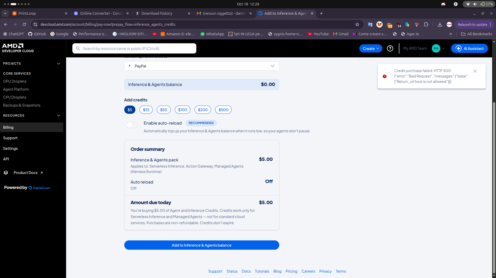

# Friction log

Problems that cost the team time during the hackathon, outside the code. One entry per issue: what happened, the
impact, what we did, and what is still open. Add new entries at the top.

## AMD MI300X droplet: creation fails although funds were added, and the promised credits never arrived

| | |
| :-- | :-- |
| When | October 2026, during the hackathon |
| Where | AMD Developer Cloud, GPU droplet creation (MI300X) |
| Status | Open |

**What happened**

- Creating the MI300X droplet failed with an error from AMD, so we could not bring up the GPU machine for the
  vLLM-ROCm serving (`infra/serve_gemma_vision.sh`, `infra/serve_vision_e4b_vllm.sh`) or the fine-tuning
  (`finetune/`, `configs/train_mi300x.yaml`).
- The error persisted **after we added real money** to the account: the balance was there, the droplet still could
  not be created.
- We were also **expecting hackathon credits** on the account. They never arrived, which is why we topped up with
  our own money in the first place.

**Impact**

- Deploying the models on the MI300X was blocked; time went into retrying and checking the account instead of the
  build.
- We paid out of pocket for compute we could not use.
- The 26B kept running on the homelab llama.cpp router (CT 100, see [`deploy/README.md`](../../deploy/README.md)),
  so the demo did not depend on the droplet.

**Still open / to follow up**

**Suggestion for the organizers**

Confirm credits on the account before the event starts, and show a clear reason when droplet creation is refused
(quota, region capacity, account verification, billing) instead of a generic error.
